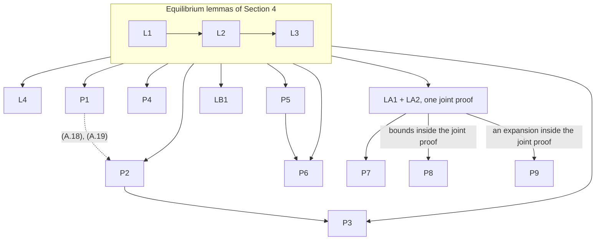

# Theory: the technical statements of the paper and their proofs

This file collects the model, the assumptions and the sixteen formal results (lemmas and propositions) of *Dynamic Competition in Online Retailing: Implications of Customer-to-Customer Interactions* (Zheyu Jiang, Xin Geng, Nan Yang, Renyu Zhang). It is what the verification of this repository checks.

The model, statements and proofs follow the LaTeX source in `paper/`. Cross-references and equation numbers use the printed numbering, and the paper's shorthand macros are expanded. Each result lists its **Differences from the paper**. The statement of LB1 makes its maintained price restriction explicit for standalone reading. Editorial notes explain equality cases in P1, the quantifiers of the printed thresholds in P5.c2 and P6.c2, and the derivative bound in the joint proof of LA1 and LA2 used by P8.

Conventions. Throughout the paper and this file, *increasing* means nondecreasing and *decreasing* means nonincreasing. *Strictly increasing*, *strictly decreasing*, and explicit inequalities such as $>$ and $<$ retain their strict meaning. Assumptions are cited by the IDs listed under *Notation and assumptions* (A1 to A15, I1 to I3). Results are cited by ID: L1 to L4 are Lemmas 1 to 4, P1 to P9 are Propositions 1 to 9, LA1 and LA2 are Lemmas A.1 and A.2, and LB1 is Lemma B.1. A part of a result is written after a dot, as in `P5.c1`. The numerical checks in `numerics/` use the same IDs.

To verify the results, start with the *Verification roadmap* below and the procedure in `AGENTS.md`.

## Index

| ID | Result | In the paper | Differences |
|---|---|---|---|
| [L1](#l1) | Lemma 1: Benchmark inventory equilibrium without C2C interactions | Section 4 | none |
| [L2](#l2) | Lemma 2: Two-period inventory equilibrium under within-brand C2C (Scenario S) | Section 4 | none |
| [L3](#l3) | Lemma 3: Two-period inventory equilibrium under cross-brand C2C (Scenario N) | Section 4 | none |
| [L4](#l4) | Lemma 4: Retailer A orders more per unit of market share | Section 4 | none |
| [P1](#p1) | Proposition 1: First-period order quantity of retailer A | Section 4 | none |
| [P2](#p2) | Proposition 2: First-period order quantity of retailer B | Section 4 | none |
| [P3](#p3) | Proposition 3: Expected first-period sales of each retailer | Section 4 | none |
| [P4](#p4) | Proposition 4: Total expected first-period sales in Scenario N | Section 4 | none |
| [P5](#p5) | Proposition 5: Equilibrium profit of retailer A across scenarios | Section 4 | none |
| [P6](#p6) | Proposition 6: Equilibrium profit of retailer B across scenarios | Section 4 | none |
| [LA1](#la1) | Lemma A.1: Inventory and second-period price equilibrium in Scenario S for large gamma | Online Appendix A.2 | none |
| [LA2](#la2) | Lemma A.2: Inventory and second-period price equilibrium in Scenario N for large gamma | Online Appendix A.2 | none |
| [P7](#p7) | Proposition 7: Second-period order quantities as functions of second-period prices | Section 5 | none |
| [P8](#p8) | Proposition 8: First-period order quantities as functions of first-period prices | Section 5 | none |
| [P9](#p9) | Proposition 9: Equilibrium price paths rise under within-brand and fall under cross-brand C2C | Section 5 | none |
| [LB1](#lb1) | Lemma B.1: Inventory equilibrium with mixed within-brand and cross-brand C2C | Online Appendix B | yes |

## Verification roadmap

This section is a map for an agent, or a reader, who verifies the sixteen results. `AGENTS.md` gives the procedure and the format of the records. The map says what depends on what, in which order to work, and what kind of argument each proof makes.

### Dependencies

An arrow from X to Y means that the proof of Y uses X. An arrow that leaves the box of Lemmas 1 to 3 means that the proof uses one or more of them. The column *Uses* of the table below gives the exact list.

Dotted arrows are equations that one proof displays and another uses. Equations (A.1), (A.5) and (A.7), displayed in the proofs of Lemmas 1 and 2, are also used in the proof of Lemma 3.

Two dependencies go beyond the statements of the cited results:

- The proof of Proposition 8 differentiates the expansions of Lemmas A.1 and A.2 in the first-period prices. It needs the bounds with derivatives that the joint proof of the two lemmas establishes.
- The proof of Proposition 9 uses the expansion of the total profit $\Pi_i^N$ that the joint proof derives in its last paragraph.

Check those intermediate claims of the joint proof as part of LA1 and LA2, and note in the records of P8 and P9 which ones they rely on.

### Order

| Stage | Results | Why in this order |
|---|---|---|
| 0 | none: `theory.md` and `numerics/` against the paper | Part 1 of `AGENTS.md`. Everything later reads `theory.md` and runs the code, so their consistency with the paper comes first. |
| 1 | L1, L2, L3, then LB1 | These equilibrium lemmas allow any seed demand distribution $F$ with interval support and a strictly positive density on its interior (A3). Every later result of Section 4 uses their closed forms. LB1 repeats the argument of L3 with mixed weights. |
| 2 | L4, P1, P2, P3, P4, P5, P6 | Comparative statics of those closed forms under the uniform distribution (A10) and the price condition A11. Do P1 before P2 and P3, and P5 before P6. |
| 3 | LA1 and LA2 together | One joint proof, the longest in the paper. Section 5 drops A11 and lets prices be chosen. |
| 4 | P7, P8, P9 | They rest on stage 3. |
| any | F1, FB1, N1 to N6 | The numerical statements. They do not depend on the proofs. N7 is listed in `numerics/numerical_statements.yaml` and excluded. |
| last | none: overall judgement and summary | Part 4 of `AGENTS.md`, once everything above is done. |

Stages 1 and 2 do not use stages 3 and 4, and the reverse holds except that the joint proof of stage 3 refers to the arguments of L2 and L3. After stage 0, two agents can therefore work in parallel, one on stages 1 and 2 and one on stages 3 and 4, with the numerical statements given to either.

### Map of the results

Claim types, by part: *universal* holds for every admissible parameter, *threshold* holds for $\gamma$ above a threshold whose existence the statement asserts, *asymptotic* holds for $\gamma$ large with remainder terms of a stated order. Proof lengths are counts of words outside formulas, to size the work.

| ID | Claim type of each part | Proof: where, and the equations it displays | Uses | How the proof argues | Direct checks in `numerics/tests/` |
|---|---|---|---|---|---|
| [L1](#l1) | eq, unique: universal | Online Appendix A.1, (A.1) to (A.3), about 300 words | none | Each retailer's profit is concave in its own order. The probability (A.1) gives the best responses (A.2), (A.3), which cross once. | `test_equilibria_from_primitives.py`, `test_port_matches_paper.py` |
| [L2](#l2) | first, second, unique, profits: universal | Online Appendix A.1, (A.4) to (A.11), about 750 words | L1, (A.1) | Backward induction. In period 2 the game is the benchmark shifted by $\gamma R_{i,1}$. In period 1 each profit is concave and the best responses are as in Lemma 1 with modified critical ratios. | as L1, and `test_profits_and_price_game.py` |
| [L3](#l3) | first, second, unique, profits: universal | Online Appendix A.1, (A.12) to (A.17), about 1,100 words | L2, (A.1), (A.5), (A.7) | Period 2 as in L2 with a common market. The critical-ratio ordering excludes the opposite order region. Inverting the two first-order conditions in sequence gives the unique equilibrium. | as L2 |
| [L4](#l4) | a, b: universal | Online Appendix A.1, no display, about 70 words | L1, L2, L3 | Differences of the closed forms. | `test_propositions_exogenous.py` |
| [P1](#p1) | i: universal, ii: threshold | Online Appendix A.1, (A.18), (A.19), about 350 words | L1, L2, L3 | Derivatives in $\theta$ of the closed forms. Signs of the difference at $\theta=0$ and $\theta=1$ for large $\gamma$, then convexity in $\theta$ for a single crossing. | `test_propositions_exogenous.py` |
| [P2](#p2) | a, b, c: universal | Online Appendix A.1, (A.20), about 230 words | L1, L2, L3, (A.18), (A.19) | (a), (b) from the closed forms and (A.19). (c) from the sign of the derivative in $\gamma$, a polynomial in $\gamma$. | `test_propositions_exogenous.py` |
| [P3](#p3) | a: threshold for monotonicity, cutoff in $[0,1]$ for every $\gamma>0$, b: universal | Online Appendix A.1, one unnumbered display | L2, L3, P2 | Critical-ratio ordering and convexity give monotonicity. Concavity of the sales difference gives its cutoff, including a cutoff of one. Part (b) from P2. | `test_propositions_exogenous.py` |
| [P4](#p4) | threshold | Online Appendix A.1, no display, about 90 words | L3 | Sign pattern of the derivative of total sales in $\theta$. | `test_propositions_exogenous.py` |
| [P5](#p5) | a, b, c1, c2: threshold | Online Appendix A.1, three unnumbered displays | L2, L3 | Two squares give the sign in (a), and a uniform sales bound gives the profit comparison in (c1). Signs of the leading coefficients in $\gamma$ give opposite endpoint signs for (c2) at fixed admissible costs. A polynomial of degree at most three in $\theta$ gives the crossing. | `test_propositions_exogenous.py` |
| [P6](#p6) | a, b, c1, c2: threshold | Online Appendix A.1, no display, about 330 words | L2, L3, P5 | The method of P5 for retailer B, with a polynomial of degree one in $\theta$. | `test_propositions_exogenous.py` |
| [LA1](#la1) | a, b: asymptotic | Online Appendix A.2, joint with LA2, (A.21), about 1,300 words for both | L2, L3 | For large $\gamma$: small orders are dominated, so first-period sales are bounded below. Then the second-period price game has the corner equilibrium $(\overline{p},\overline{p})$, and the large-$\gamma$ critical-ratio ordering allows the first-period subgame argument of Lemma 2. | `test_section_5_first_period.py`, `test_section_5_second_period.py` |
| [LA2](#la2) | a, b: asymptotic | the joint proof under LA1 | L2, L3 | Second period: Lipschitz best responses and Banach's theorem for uniqueness, the implicit function theorem for the price expansion. First period: domination bounds, strict concavity after taking expectations, Brouwer's theorem, an ordering argument by contradiction, exact first-order conditions, and expansion in $\gamma^{-1}$. | as LA1 |
| [P7](#p7) | a, b: universal, for every $\gamma$ | Online Appendix A.2, no display, about 260 words | the second-period parts of LA1 and LA2 | The benchmark orders switch branches at equal cost/price ratios. Given sales, the within-brand shift is fixed and the cross-brand shift $\gamma\alpha_{i,2}R_1$ is affine in prices. | `test_proposition_7_shapes.py` |
| [P8](#p8) | a, b1, b2: asymptotic | Online Appendix A.2, (A.22) to (A.26), about 340 words | LA1, LA2, and bounds inside their joint proof | Differentiate the expansions of LA1 and LA2 in the first-period prices. (b2) builds a price neighbourhood under condition (A.22). | `test_section_5_propositions.py` |
| [P9](#p9) | a, b: asymptotic | Online Appendix A.2, no display, about 220 words | LA1, LA2, and an expansion inside their joint proof | The reduced first-period price game. Scenario S: each payoff decreases in the own first-period price for large $\gamma$, so the lower bound is the unique best response. Scenario N: a contraction gives uniqueness, and the limit game gives interior prices. | `test_section_5_propositions.py` |
| [LB1](#lb1) | first, second, unique: universal | Online Appendix B, no display, about 250 words | L3, by analogy | The argument of L3 with the weights $\lambda^S$, $\lambda^N$ of the mixed scenario. | `test_equilibria_from_primitives.py`, `test_port_matches_paper.py` |

### What the numerical checks settle

- A *universal* part holds at every admissible point, so a numerical check is a search for counterexamples. A pass at many random and boundary points is strong evidence, and the proof is still needed for the general case.
- A *threshold* part asserts that some $\gamma^\ast$ exists. The checks evaluate the claim on a ladder of large $\gamma$, stated in each check under *Points*. A pass shows that the claim holds there, not that a threshold exists. Only the proof settles that, so the proof audit carries the weight for these parts.
- An *asymptotic* part asserts a limit or a rate. The checks measure the remainder along increasing $\gamma$ and compare it with the stated order. The proof is again what settles the claim.
- The proofs of P1 to P6 consist mostly of derivatives of the closed forms of Lemmas 1 to 3 and signs of polynomial coefficients. Re-deriving them with a computer algebra system, from the closed forms, is faster and more reliable than reading. `numerics/c2c/closed_form.py` gives the closed forms in floating point and states the formula each line comes from.

### Points to check in every proof

These come from the structure of the model, and each one can change whether a statement is strict, or for which parameters it holds.

1. **Which retailer has the higher critical fractile.** Lemmas 1 to 3 state the equilibrium for the case in which retailer A's fractile is the higher one. Section 4 gets that from A11. Section 5 does not assume A11. Wherever a proof uses the form of an equilibrium, check that the ordering holds there.
2. **Boundaries.** The lower bound of A11 with equality, $\theta=0$ and $\theta=1$, equal shares $\alpha_{i,1}=\alpha_{i,2}$, and critical fractiles at the ends of the support. Equality is compatible with increasing or decreasing. Check any explicit strict sign at these boundaries.
3. **Order of quantifiers.** For each threshold ($\gamma^A$, $\Delta^A$, $\theta^A$, and so on), find what it may depend on and check that the statement allows that dependence. Check whether a threshold is uniform in $\theta$ when a later result needs that.
4. **Expansions that are differentiated later.** An $O(\cdot)$ remainder controls the value, not its derivatives, unless it is stated in a norm with derivatives, as the notation $O_{C^m}$ of Online Appendix A.2 does.
5. **"By analogous arguments" and "one can check".** Re-derive the step, or test it numerically.
6. **Cross-references typed by hand.** Equation numbers in the statements of the main text are not all generated by LaTeX. Check that each points to the intended display.

## Model (Section 3 of the paper)

We study a two-period duopoly competition in which two online retailers sell substitutable perishable products and the market evolves across periods through C2C interactions. In each period, the retailers compete in price and inventory, while stockout-based substitution may redirect unmet demand from one retailer to the other. We first describe the firms, then present the aggregate demand dynamics in the order in which they arise, and finally conclude the section by formulating the retailers' dynamic optimization problems.

### 3.1 Firms

Consider two online retailers, A and B, selling substitutable perishable products in two consecutive sales seasons (periods). For example, Amazon Fashion and Shein may both offer fall collections (e.g., plaid jackets and Halloween-themed apparel) and winter collections (e.g., fur jackets and holiday-themed clothes). In period $t$, retailer $i$ ($i=A,B$) sets its price $p_{i,t}$ and then decides its stocking level $y_{i,t}$. The two retailers are asymmetric in unit ordering cost, $c_i$. Without loss of generality, retailer A has a lower unit ordering cost than retailer B, i.e., $c_A<c_B$.

Products are perishable within our two-period setting. Any leftovers at the end of a period are salvaged through other channels, and we normalize the salvage value to zero. Likewise, unmet demand does not carry over across selling seasons. This assumption is particularly natural for seasonal fashion products whose product categories and purchase occasions change across successive seasons.

### 3.2 Demand and Market Dynamics

The demand process consists of three components that arise sequentially: (i) seed demand is generated and split between the retailers; (ii) prior realized sales generate market growth through C2C interactions; and (iii) after inventory availability is resolved, stockouts may induce substitution between the retailers.

#### 3.2.1 Seed Demand and Demand Split.

In every period $t$, there is a seed demand $X_t$ representing the common underlying market for the two retailers. The sequence $\{X_t\}$ is i.i.d. with distribution $F(\cdot)$ and density $f(\cdot)$. In the seasonal-fashion example, this seed demand captures consumers who enter the market because of recurring seasonal purchase needs or social norms, independently of the C2C interactions that occurred in the previous period.

The seed demand is initially split between the two retailers. Let $\alpha_{i,t}$ denote retailer $i$'s share, where $\alpha_{A,t}+\alpha_{B,t}=1$. Following the deterministic demand-splitting approach in @lm1997, but allowing the split to depend on prices, we assume

$$
\alpha_{i,t}
=\alpha_{i,t}(p_{i,t},p_{j,t})
=\frac{1}{2}+\beta(p_{j,t}-p_{i,t}),
\qquad i,j=A,B;\ i\neq j,
$$

where $\beta>0$ captures the sensitivity of the aggregate demand share to price differences. Thus, retailer $i$ receives $\alpha_{i,t}X_t$ units of the seed demand before C2C-induced demand is added.

#### 3.2.2 Market Growth through C2C Interactions.

Prior customers may subsequently generate reviews, recommendations, styling posts, try-on hauls, and other customer-generated content. Such C2C communications can affect later product trial and therefore be informative for future fashion demand [see supporting evidence in, e.g., @lee2013; @baardman2023]. We therefore use realized sales in the previous period as the aggregate customer base from which subsequent C2C-induced demand may arise.

Let $Z_{i,t}$ denote retailer $i$'s incremental C2C-induced demand. Retailer $i$'s demand before any current-period stockout occurs is then

$$
M_{i,t}=\alpha_{i,t}X_t+Z_{i,t}. \tag{1}
$$

We refer to $M_{i,t}$ as retailer $i$'s *pre-stockout demand*. The form of $Z_{i,t}$ depends on whether the C2C interaction is primarily within-brand or cross-brand.

**Within-Brand C2C Interactions (Scenario S).**
Under within-brand C2C, communication generated by a retailer's prior customers directs incremental demand toward that retailer. This can occur when customer-generated content contains seller- or product-specific information that reduces uncertainty, facilitates product trial, or otherwise increases interest in the focal seller's offering. As mentioned in Section 1, the viral Aerie leggings and UNIQLO shoulder-bag episodes illustrate this mechanism [@businessinsider2021; @guardian2023uniqlo]; moreover, empirical studies document social learning, product trial, and customer-driven trend effects in online fashion [see, e.g., @lee2013; @baardman2023].

We model this case as $Z_{i,t}^S=\gamma R_{i,t-1}^S$, where $\gamma>0$ captures the strength of C2C-induced market growth and $R_{i,t-1}^S$ is retailer $i$'s realized sales in the previous period. Hence,

$$
M_{i,t}^S=\alpha_{i,t}X_t+\gamma R_{i,t-1}^S . \tag{2}
$$

Thus, under Scenario S, the additional demand generated by retailer $i$'s previous customers enters retailer $i$'s pre-stockout demand.

**Cross-Brand C2C Interactions (Scenario N).**
Customer communication may instead increase interest in a broader product category, style, functionality, or use occasion rather than direct the additional demand toward the originating retailer. Real-world stories about Miu Miu ballet-flat, mesh-flat, and Adidas–Puma terrace-shoe illustrate how attention surrounding particular products can broaden into category-level interest that competing brands may capture [@fashionista2022miumiu; @forbes2024mesh; @reuters2023terrace; @reuters2024puma]. Empirical studies likewise document such spillovers across competing products [e.g., @cola2020; @haviv2020; @shi2023]. We refer to this case as cross-brand C2C, or Scenario N.

Let $R_{t-1}^N=R_{A,t-1}^N+R_{B,t-1}^N$ denote total realized sales in the previous period. Under Scenario N, these sales generate an incremental common market $\gamma R_{t-1}^N$, which is subsequently split between the two retailers according to the same rule, characterized by $\alpha_{i,t}$, as for the seed demand of that period. Therefore, $Z_{i,t}^N=\alpha_{i,t}\gamma R_{t-1}^N$, and

$$
M_{i,t}^N=\alpha_{i,t}\left(X_t+\gamma R_{t-1}^N\right). \tag{3}
$$

The distinction between Scenarios S and N is therefore where the C2C-induced incremental demand enters the competitive market. Under within-brand C2C, it is attributed to the originating retailer, whereas under cross-brand C2C, it first expands the common market and is then divided between the retailers.

#### 3.2.3 Stockout-Based Substitution.

The first two components determine each retailer's pre-stockout demand $M_{i,t}$. Stockout-based substitution occurs subsequently, after current-period inventory availability is resolved. Importantly, under within-brand C2C, the fact that the C2C-induced demand is initially directed toward the same retailer does not imply that these customers are unaware of competing alternatives after inventory availability is known. Once a stockout is observed, search, recommendations, or other availability information may direct customers to the competing retailer and enable substitution. If retailer $j$ stocks out, a fraction $\theta\in[0,1]$ of its unmet pre-stockout demand is redirected to retailer $i$. Therefore, retailer $i$'s effective demand is

$$
D_{i,t}=M_{i,t}+\theta\left(M_{j,t}-y_{j,t}\right)^+, \qquad i,j=A,B;\ i\neq j.
$$

A larger $\theta$ represents a greater degree of stockout-based substitution and hence more intense inventory competition. This formulation follows the classical competitive inventory model and is consistent with empirical evidence that stockouts can redirect part of unmet demand toward available alternatives [see, e.g., @lee2016; @li2023; @ergin2022].
Finally, retailer $i$'s realized sales and period profit are $R_{i,t}=\min\{D_{i,t},y_{i,t}\}$ and $\pi_{i,t}=p_{i,t}R_{i,t}-c_i y_{i,t}$, respectively.

#### 3.2.4 Remarks.

The three components above describe the aggregate market dynamics used in our analysis: seed demand is first split between the retailers, prior realized sales then generate C2C-induced demand, and stockout-based substitution finally reallocates part of unmet demand after inventory availability is resolved. Our aggregate demand system is not derived from a formal consumer-level micro-foundation. The empirical evidence and prior literature motivate these component mechanisms, but do not jointly derive the complete demand system. We therefore use this reduced-form framework to obtain tractable insights into how different types of C2C interactions affect dynamic inventory competition and pricing. Developing an integrated micro-foundation model that jointly captures these mechanisms is an important direction for future research.

### 3.3 Problem Formulation

Together, these model elements define a two-period competitive newsvendor problem formulated as a two-player Nash game with complete information. Because the underlying mechanism of C2C interactions becomes operative after one transition between selling seasons, a two-period model is sufficient to isolate its strategic effect while preserving analytical tractability.

The sequence of events in period $t$ is as follows. (1) The retailers observe the previous-period realized sales $(R_{A,t-1},R_{B,t-1})$; for $t=1$, we set $R_{i,0}=0$. (2) The retailers choose prices $p_{i,t}$ and then stocking levels $y_{i,t}$, with each decision made simultaneously across retailers. (3) Seed demand $X_t$ is realized and split according to $\alpha_{i,t}$; when $t=2$, C2C-induced demand generated by previous realized sales is added according to Scenario S or Scenario N, yielding pre-stockout demand $M_{i,t}$. (4) Inventory availability is resolved and stockout-based substitution determines effective demand $D_{i,t}$; realized sales $R_{i,t}$ and profit $\pi_{i,t}$ then follow.

The objective of retailer $i$ is to maximize its total discounted profit across the two periods. As such, retailer $i$ solves

$$
(\mathcal{P}) \qquad \max_{p_{i,1},y_{i,1}; p_{i,2},y_{i,2}} \mathbb{E}_{X_1,X_2} \left[ \left( p_{i,1}R_{i,1}-c_iy_{i,1} \right) +\rho\left( p_{i,2}R_{i,2}-c_iy_{i,2} \right) \right] ,
$$

subject to

$$
R_{i,t}=\min\{D_{i,t}, y_{i,t}\}, D_{i,t}=M_{i,t}+\theta (M_{j,t}-y_{j,t})^+, \mbox{ and } M_{i,t} = \alpha_{i,t} X_t + Z_{i,t}; \quad t=1, 2.
$$

The parameter $0<\rho\leq 1$ is the discount factor. The equilibrium concept adopted is feedback Nash equilibrium. We treat the sales $R_{i,t}$ as state variables in each period, and solve for the prices $p_{i,t}$ and the order quantities $y_{i,t}$ via backward induction.

This two-period model highlights the complexities online retailers face in pricing and inventory management when different types of C2C interactions have significant influences on demand.
However, such price-inventory competition in multiple periods is analytically difficult to solve. Hence, in this paper, we consider two models. First, we assume that the prices in both periods are fixed and study the Exogenous Price Model in Section 4. Then, in Section 5, we investigate the retailers' pricing decisions in the Endogenous Price Model and derive relevant insights into the impact of pricing flexibility. Lastly, we will set the discount factor $\rho=1$ and assume a uniform distribution for the seed demand for the rest of the paper; that is, let $X_t\sim U[\mu-\sigma,\mu+\sigma]$ for $t=1,2$ ($\mu > \sigma$). Note that we have obtained the equilibrium of the Exogenous Price Model with any $\rho\in(0,1]$ and a general seed demand distribution with interval support and a strictly positive density on the interior of that interval (see the proofs in Appendix A.1). Moreover, we have numerically tested that all our results remain qualitatively the same with other distributions.

## Notation and assumptions

### Notation
An index of the symbols. It is an aid for readers and is not paper text. The definitions are in the section *Model* unless another location is given.

#### Primitives

| Symbol | Meaning |
|---|---|
| $i, j \in \{A, B\}$, $i \neq j$ | The two retailers. Retailer A has the lower unit cost. |
| $t \in \{1, 2\}$ | Period (selling season). |
| $c_i$ | Unit ordering cost, $c_A < c_B$. $\Delta c = c_B - c_A$. |
| $p_{i,t}$ | Retail price. Exogenous in Section 4, chosen in $[\underline{p}, \overline{p}]$ in Section 5. |
| $y_{i,t}$ | Order quantity (stocking level). |
| $X_t$ | Seed demand, i.i.d. with distribution $F$ and density $f$. The paper specializes to $X_t \sim U[\mu-\sigma, \mu+\sigma]$ with $\mu > \sigma$ from Section 4 on. Lemmas 1 to 3 and B.1 also allow other distributions with interval support and strictly positive interior density. |
| $\beta > 0$ | Sensitivity of the demand split to the price difference. |
| $\gamma > 0$ | Strength of C2C-induced market growth. |
| $\theta \in [0,1]$ | Share of a stocked-out retailer's unmet demand that moves to the rival. |
| $\rho \in (0,1]$ | Discount factor. Set to 1 from Section 4 on. |
| $\lambda^S, \lambda^N$ | Weights of within-brand and cross-brand C2C in the mixed scenario of Online Appendix B, $\lambda^S + \lambda^N = 1$. |

#### Demand system

| Symbol | Meaning |
|---|---|
| $\alpha_{i,t} = \tfrac12 + \beta(p_{j,t} - p_{i,t})$ | Share of the seed demand. $\alpha_{A,t} + \alpha_{B,t} = 1$. |
| $Z_{i,t}$ | C2C-induced demand. $Z^S_{i,t} = \gamma R_{i,t-1}$ in Scenario S. $Z^N_{i,t} = \alpha_{i,t}\gamma R_{t-1}$ in Scenario N. |
| $M_{i,t} = \alpha_{i,t} X_t + Z_{i,t}$ | Pre-stockout demand. |
| $D_{i,t} = M_{i,t} + \theta (M_{j,t} - y_{j,t})^+$ | Effective demand after stockout-based substitution. |
| $R_{i,t} = \min\{D_{i,t}, y_{i,t}\}$ | Realized sales. $R_t = R_{A,t} + R_{B,t}$. $R_{i,0} = 0$. |
| $\pi_{i,t} = p_{i,t} R_{i,t} - c_i y_{i,t}$ | Period profit. |

#### Scenarios and equilibrium objects

| Symbol | Meaning |
|---|---|
| Superscript $0$, $S$, $N$, $G$ | Benchmark without C2C, within-brand C2C, cross-brand C2C, mixed C2C (Online Appendix B). |
| $\zeta^k_{i,t}$ | Critical fractile point of retailer $i$ in scenario $k$: $F^{-1}$ of the critical ratio. Lemmas 1 to 3 and B.1. |
| $y^k_{i,t}$ | Equilibrium order quantity. |
| $L^k_{i,t}$ | Leftover inventory at equilibrium, so that $R^k_{i,t} = y^k_{i,t} - L^k_{i,t}$. Proofs of Lemmas 1 to 3. |
| $\pi^0_{i,t}$ | Equilibrium profit of one period in the benchmark. Proof of Lemma 1. |
| $\Pi^k_i$ | Equilibrium total profit over the two periods in scenario $k$. |
| $\gamma_{i,t}, \gamma^C_{i,t}$ | Own and cross coefficients of C2C-induced demand in the mixed scenario. Online Appendix B. |

#### Section 5 and Online Appendix A.2

| Symbol | Meaning |
|---|---|
| $[\underline{p}, \overline{p}]$, $\mathcal{P} = [\underline{p}, \overline{p}]^2$ | Price interval and the set of price pairs. |
| $\widehat p_{i,2} = \tfrac{1}{2\beta} + \tfrac{2c_i + c_j}{3}$ | Limit second-period price in Scenario N. |
| $\nu_i$ | Limit second-period margin times share at the limit prices. |
| $O_{C^m(x;D)}(\varepsilon_\gamma)$ | A function whose derivatives up to order $m$ are bounded by a constant times $\varepsilon_\gamma$, uniformly on $D$, for all large $\gamma$. |
| $V_i(\cdot)$ | Second-period equilibrium profit as a function of the first-period sales state. |
| $\gamma^A, \gamma^B, \gamma^R, \gamma^P, \gamma^D, \ell^D$ | Thresholds whose existence the propositions assert. |
| $\theta^A, \theta^B, \underline{\theta}^{SN}, \underline{\theta}'$, $\Delta^A, \Delta^B$ | Thresholds in $\theta$ and in the cost difference. |

### Assumptions

The paper states its assumptions in running text. Each one has an ID here, with the authors' words quoted. Titles and scopes are editorial.

- **A1. Cost asymmetry.** "Without loss of generality, retailer A has a lower unit ordering cost than retailer B, i.e., $c_A<c_B$." *Scope:* All results.
- **A2. Perishable products, zero salvage value, no backlogging.** "Products are perishable within our two-period setting. Any leftovers at the end of a period are salvaged through other channels, and we normalize the salvage value to zero. Likewise, unmet demand does not carry over across selling seasons." *Scope:* All results.
- **A3. Seed demand and the distributional condition for equilibrium.** "The sequence $\{X_t\}$ is i.i.d. with distribution $F(\cdot)$ and density $f(\cdot)$." "Note that we have obtained the equilibrium of the Exogenous Price Model with any $\rho\in(0,1]$ and a general seed demand distribution with interval support and a strictly positive density on the interior of that interval (see the proofs in Appendix A.1)." *Scope:* The i.i.d. density assumption applies to the model and all results. The interval-support and interior-positivity conditions apply to the general-distribution equilibria in Lemmas 1 to 3 and B.1. The uniform law in A10 satisfies both conditions.
- **A4. Linear price-dependent split of the seed demand.** "Let $\alpha_{i,t}$ denote retailer $i$'s share, where $\alpha_{A,t}+\alpha_{B,t}=1$." "where $\beta>0$ captures the sensitivity of the aggregate demand share to price differences." *Scope:* All results.
- **A5. Within-brand C2C interactions (Scenario S).** "We model this case as $Z_{i,t}^S=\gamma R_{i,t-1}^S$, where $\gamma>0$ captures the strength of C2C-induced market growth and $R_{i,t-1}^S$ is retailer $i$'s realized sales in the previous period." *Scope:* Results for Scenario S.
- **A6. Cross-brand C2C interactions (Scenario N).** "Under Scenario N, these sales generate an incremental common market $\gamma R_{t-1}^N$, which is subsequently split between the two retailers according to the same rule, characterized by $\alpha_{i,t}$, as for the seed demand of that period." *Scope:* Results for Scenario N.
- **A7. Stockout-based substitution at rate theta.** "If retailer $j$ stocks out, a fraction $\theta\in[0,1]$ of its unmet pre-stockout demand is redirected to retailer $i$." *Scope:* All results.
- **A8. Timing, information and initial state.** "(1) The retailers observe the previous-period realized sales $(R_{A,t-1},R_{B,t-1})$; for $t=1$, we set $R_{i,0}=0$. (2) The retailers choose prices $p_{i,t}$ and then stocking levels $y_{i,t}$, with each decision made simultaneously across retailers." *Scope:* All results.
- **A9. Discounting and equilibrium concept.** "The parameter $0<\rho\leq 1$ is the discount factor. The equilibrium concept adopted is feedback Nash equilibrium." *Scope:* All results.
- **A10. No discounting and uniform seed demand from Section 4 onward.** "Lastly, we will set the discount factor $\rho=1$ and assume a uniform distribution for the seed demand for the rest of the paper; that is, let $X_t\sim U[\mu-\sigma,\mu+\sigma]$ for $t=1,2$ ($\mu > \sigma$)." *Scope:* Lemma 4, Propositions 1 to 9, Lemmas A.1 and A.2, and all numerical results. The first-period formulas printed in Lemmas 2, 3 and B.1 use $\rho=1$. The Online Appendix extends Lemmas 1 to 3 and Lemma B.1 to seed demand distributions satisfying the support and density conditions in A3, and Lemmas 1 to 3 to any discount factor in (0, 1].
- **A11. Exogenous prices with a bounded price advantage for retailer A.** "In this section, we assume that retail prices in each period, $p_{i,t}$ ($i=A,B;t=1,2$), are predetermined and fixed." "that $p_{B,t}\geq p_{A,t} \geq \frac{c_A}{c_B} p_{B,t}$ for $t=1,2$." *Scope:* Section 4 only (Lemmas 1 to 4, Propositions 1 to 6) and Lemma B.1.
- **A12. Bounded endogenous prices.** "we simply assume all prices are bounded, i.e., $p_{i,t} \in [\underline{p}, \overline{p}]$ ($i, j = A, B; t = 1,2$), where $\underline{p} >c_B$ and $0<\beta<1/[2(\overline{p}-\underline{p})]$." *Scope:* Section 5 only (Propositions 7 to 9, Lemmas A.1 and A.2).
- **A13. Price bounds are not restrictive.** "We assume that the pricing bounds are sufficiently nonrestrictive. [Footnote: Specifically, $\underline{p}<\frac{1}{2\beta}+\frac{2c_A+c_B}{3}$ and $\overline{p}>\frac{1}{2\beta}+\frac{(\mu+\sigma)(c_A+2c_B)}{3\mu}$; see Appendix A for details.]" *Scope:* Section 5 only (Propositions 7 to 9, Lemmas A.1 and A.2).
- **A14. Strong C2C interactions (large gamma).** "To obtain clean results and extract clear insights, we focus our analysis on the case where the social interactions are strong (i.e., $\gamma$ is large), and we numerically investigate the general situations." *Scope:* Lemmas A.1 and A.2 and Propositions 8 and 9. Proposition 7 holds for every gamma. Several results of Section 4 also hold only above a threshold of gamma, which each statement names.
- **A15. Weights of the mixed scenario.** "let $\lambda^S$ [$\lambda^N$] be the weight of the within-brand [cross-brand] C2C interactions, where both $\lambda^k \in [0,1]$ and $\lambda^S + \lambda^N = 1$." *Scope:* Online Appendix B only (Lemma B.1 and Figure B.1).

### Implicit conditions

The analysis uses these conditions, but the paper does not state them as assumptions. They are not paper text.

- **I1. Positive unit costs and prices above cost.** The interior benchmark fractiles require $0<c_i<p_{i,t}$. The proof of Lemma 2 invokes positive margins, and the joint proof of Lemmas A.1–A.2 uses $c_A>0$. In Section 5 the margin condition follows from A12 and $c_A<c_B$.
- **I2. Both market shares are positive.** Section 4. The split rule A4 gives shares in (0, 1) only if beta |p_{B,t} - p_{A,t}| < 1/2. In Section 5 this follows from the bound on beta in A12.
- **I3. Critical fractiles lie in the unit interval.** Section 4 and Online Appendix B. Under A10 the closed forms use F^{-1}(x) = mu - sigma + 2 sigma x, which is meaningful only for x in [0, 1]. In Scenario N use the numerator and denominator in Lemma 3. In the mixed scenario use Lemma B.1, which distinguishes $\gamma_{B,2}$ from $\gamma^C_{B,2}$. Under A11 and I1–I2 the equilibrium tail probabilities in both cases are strictly between zero and one.

## Results of Section 4: exogenous prices

### Setup of the Exogenous Price Model (Section 4, opening paragraph)

In this section, we assume that retail prices in each period, $p_{i,t}$ ($i=A,B;t=1,2$), are predetermined and fixed. Such an exogenous price model may be suitable considering the practical constraints in the digital selling environment. Livestreaming campaigns, promotional commitments, platform policies, and the seasonal nature of fashion and holiday-themed apparel may discourage short-term price adjustments. Moreover, competitive environments often lead to price convergence at the start of the season, leaving inventory as the primary decision variable for retailers. In the following, we scrutinize the two-period inventory competition between the two retailers; i.e., in period $t$, after the retailers observe the previous sales volumes, they only decide their stocking levels $y_{i,t}$. We first derive the equilibrium of the competition in different scenarios and then present our main findings regarding the equilibrium comparisons between scenarios. To preserve the structural properties of the objective functions, we make a mild technical assumption [Footnote: This assumption is made only to obtain structured results in this section; the model can still be solved without it (see Online Appendix). Moreover, we will drop the assumption in the next section for the Endogenous Price Model.] that $p_{B,t}\geq p_{A,t} \geq \frac{c_A}{c_B} p_{B,t}$ for $t=1,2$. Since $c_A<c_B$, it is intuitive that retailer A can set a lower price due to its cost efficiency; our assumption simply requires that the price advantage is not too large.

### L1

**Lemma 1: Benchmark inventory equilibrium without C2C interactions.**

- **In the paper:** Lemma 1 (`lem:model0`), Section 4; proof in Online Appendix A.1.
- **Hypotheses:** A1, A2, A3, A4, A7, A8, A9, A11, I1, I2.
- **Parts:**
  - `L1.eq`: The stated pair of order quantities is a Nash equilibrium of the inventory game of each period.
  - `L1.unique`: It is the only Nash equilibrium.
- **Differences from the paper:** None.

#### Statement

**Lemma 1** (`lem:model0`)**.**
Suppose there is no C2C interaction. A unique Nash equilibrium exists: $y^{0}_{A,t} = (\alpha_{A,t} + \theta \alpha_{B,t}) \zeta_{A,t}^0 - \theta \alpha_{B,t} \zeta_{B,t}^0$ and $y^{0}_{B,t} = \alpha_{B,t} \zeta_{B,t}^0$, where $\zeta_{i,t}^0= F^{-1}(1 - \frac{c_i}{p_{i,t}})$ ($i = A, B; t= 1, 2$).

#### Proof

**Proof of Lemma 1**: In the benchmark scenario, retailer A maximizes its single-period profit in each period $t$:

$$
\max_{y_{A,t}} p_{A,t} \mathbb{E}\left[y_{A,t} \wedge D_{A,t} \right] - c_A y_{A,t} = (p_{A,t} - c_A )y_{A,t} - p_{A,t} \mathbb{E} \left[y_{A,t} - D_{A,t} \right]^+,
$$

where $D_{A,t} = \alpha_{A,t} X_t + \theta \left[\alpha_{B,t} X_t - y_{B,t} \right]^+$. Retailer A's profit is concave in $y_{A,t}$ and its derivative w.r.t $y_{A,t}$ is $p_{A,t} - c_A - p_{A,t} \mathbf{Prob} \left(D_{A,t} \leq y_{A,t} \right)$, where

$$
\mathbf{Prob} \left(D_{A,t} \leq y_{A,t} \right) = \int_{0}^{y_{B,t}/\alpha_{B,t}} \mathbb{1}_{ \left \{z \leq y_{A,t}/\alpha_{A,t} \right \} } f(z) dz + \int_{y_{B,t}/\alpha_{B,t}}^{+\infty} \mathbb{1}_{ \left \{z \leq \frac{y_{A,t}+\theta y_{B,t}}{\alpha_{A,t}+\theta \alpha_{B,t}} \right \} } f(z) dz. \tag{A.1}
$$

If $y_{A,t}/\alpha_{A,t} \geq y_{B,t}/\alpha_{B,t}$, $\frac{y_{B,t}}{\alpha_{B,t}} \leq \frac{y_{A,t}+\theta y_{B,t}}{\alpha_{A,t}+\theta \alpha_{B,t}} \leq \frac{y_{A,t}}{\alpha_{A,t}}$ for $\theta \in [0,1]$. Thus, by (A.1), we have $\mathbf{Prob} \left(D_{A,t} \leq y_{A,t} \right) = F\left(\frac{y_{A,t}+\theta y_{B,t}}{\alpha_{A,t}+\theta \alpha_{B,t}}\right)$. If $y_{A,t}/\alpha_{A,t} < y_{B,t}/\alpha_{B,t}$, $\frac{y_{A,t}}{\alpha_{A,t}} \leq \frac{y_{A,t}+\theta y_{B,t}}{\alpha_{A,t}+\theta \alpha_{B,t}} < \frac{y_{B,t}}{\alpha_{B,t}}$ for $\theta \in [0,1]$. Thus, by (A.1), we have $\mathbf{Prob} \left(D_{A,t} \leq y_{A,t} \right) = F\left(\frac{y_{A,t}}{\alpha_{A,t}}\right)$. Therefore, the best response of retailer A is

$$
y^*_{A,t}(y_{B,t}) = \begin{cases}
(\alpha_{A,t} + \theta \alpha_{B,t}) \zeta^0_{A,t} - \theta y_{B,t}, & \text{if $y_{B,t} \leq \alpha_{B,t} \zeta^0_{A,t}$,} \\
\alpha_{A,t} \zeta^0_{A,t}, & \text{if $y_{B,t} > \alpha_{B,t} \zeta^0_{A,t}$,}
\end{cases} \tag{A.2}
$$

where $\zeta^0_{A,t} := F^{-1}(1 - \frac{c_A}{p_{A,t}})$. On the other hand, retailer B's problem is as follows:

$$
\max_{y_{B,t}} p_{B,t} \mathbb{E}\left[y_{B,t} \wedge D_{B,t} \right] - c_B y_{B,t} = (p_{B,t} -c_B)y_{B,t} - p_{B,t} \mathbb{E} \left[y_{B,t} - D_{B,t} \right]^+,
$$

where $D_{B,t} = \alpha_{B,t} X_t + \theta \left[\alpha_{A,t} X_t - y_{A,t} \right]^+$. By analogous arguments, the best response of retailer B is

$$
y^*_{B,t}(y_{A,t}) = \begin{cases}
(\alpha_{B,t} + \theta \alpha_{A,t}) \zeta^0_{B,t} - \theta y_{A,t}, & \text{if $y_{A,t} \leq \alpha_{A,t} \zeta^0_{B,t}$,} \\
\alpha_{B,t} \zeta^0_{B,t}, & \text{if $y_{A,t} > \alpha_{A,t} \zeta^0_{B,t}$,}
\end{cases} \tag{A.3}
$$

where $\zeta^0_{B,t} := F^{-1}(1 - \frac{c_B}{p_{B,t}})$.

Since $p_{B,t} c_A/c_B \leq p_{A,t}$, we have $\zeta^0_{A,t} \geq \zeta^0_{B,t}$ for $t = 1, 2$. By combining (A.2) and (A.3), for each period $t$, there exists a unique Nash equilibrium $(y^0_{A,t},y^0_{B,t})$, where $y^0_{A,t} := (\alpha_{A,t} + \theta \alpha_{B,t}) \zeta^0_{A,t} - \theta \alpha_{B,t} \zeta^0_{B,t}$ and $y^0_{B,t} : = \alpha_{B,t} \zeta^0_{B,t}$.

Last, by substituting $y^0_{A,t}$ and $y^0_{B,t}$ into retailers' profit functions, retailers A's and B's equilibrium profits in benchmark scenario are $\pi^{0}_{A,t}$ and $\pi^{0}_{B,t}$, respectively: $\pi^{0}_{A,t} := (p_{A,t}-c_A)y^0_{A,t} - p_{A,t} \mathbb{E}[L^0_{A,t}]$ and $\pi^{0}_{B,t} := (p_{B,t}-c_B)y^0_{B,t} - p_{B,t} \mathbb{E}[L^0_{B,t}]$,
where $L^0_{A,t} := \left[(\alpha_{A,t} + \theta \alpha_{B,t}) \zeta^0_{A,t} - \theta \alpha_{B,t} \zeta^0_{B,t} - \alpha_{A,t} X_t - \theta (\alpha_{B,t} X_t - \alpha_{B,t} \zeta^0_{B,t})^+ \right]^+$ and $L^0_{B,t} := \left[\alpha_{B,t} \zeta^0_{B,t} - \alpha_{B,t} X_t - \theta \left \{\alpha_{A,t} X_t - (\alpha_{A,t} + \theta \alpha_{B,t}) \zeta^0_{A,t} + \theta \alpha_{B,t} \zeta^0_{B,t} \right \}^+ \right]^+$, $t = 1,2$. Furthermore, retailer $i$'s equilibrium sales in each period are $R^{0}_{i,t} := y^0_{i,t} - L^0_{i,t}$, $i = A,B$ and $t = 1,2$. ∎

### L2

**Lemma 2: Two-period inventory equilibrium under within-brand C2C (Scenario S).**

- **In the paper:** Lemma 2 (`lem:models`), Section 4; proof in Online Appendix A.1.
- **Hypotheses:** A1, A2, A3, A4, A5, A7, A8, A9, A11, I1, I2, and the $\rho=1$ normalization in A10 for the displayed statement. The proof retains $\rho$ in first-period continuation values.
- **Parts:**
  - `L2.first`: The stated first-period order quantities are equilibrium quantities of the two-period game.
  - `L2.second`: Given the first-period sales, the second-period equilibrium orders are the benchmark orders plus gamma times own first-period sales.
  - `L2.unique`: The equilibrium is unique.
  - `L2.profits`: Equilibrium sales and profits are as specified in the Online Appendix.
- **Differences from the paper:** None.

#### Statement

**Lemma 2** (`lem:models`)**.**
Suppose the C2C interactions are within-brand. A unique Nash equilibrium exists: In the first period, $y^{S}_{A,1} = (\alpha_{A,1} + \theta \alpha_{B,1}) \zeta_{A,1}^S - \theta \alpha_{B,1} \zeta_{B,1}^S$ and $y^{S}_{B,1} = \alpha_{B,1} \zeta_{B,1}^S$, where $\zeta^S_{i,1} = F^{-1}\left( 1 - \frac{c_i}{p_{i,1} + \gamma (p_{i,2}-c_i)}\right)$; in the second period, given the two retailers' sales, $R_{A,1}^S$ and $R_{B,1}^S$, $y^{S}_{A,2} = y_{A,2}^0 + \gamma R_{A,1}^S$ and $y^{S}_{B,2} = y_{B,2}^0 + \gamma R_{B,1}^S$. Moreover, the retailers' equilibrium sales and profits are specified in the appendix.

#### Proof

**Proof of Lemma 2**: We first study the subgame in the second period. Given the first-period seed demand $X_1$ and retailers' first-period sales, retailer A maximizes its second-period profit:

$$
\begin{aligned}
& \max_{y_{A,2}} \mathbb{E}\left[ p_{A,2}(y_{A,2} \wedge D_{A,2}) - c_A y_{A,2}|X_1 \right] \\
& = \mathbb{E} \left[ (p_{A,2} -c_A)y_{A,2} - p_{A,2} \left(y_{A,2} - \alpha_{A,2} X_2 - \gamma R_{A,1} - \theta \left(\alpha_{B,2} X_2 + \gamma R_{B,1}- y_{B,2} \right)^+ \right )^+ \bigg| X_1 \right] \\[4pt]
& = \mathbb{E} \left[ (p_{A,2} -c_A)\overline{y}_{A,2} - p_{A,2} \left(\overline{y}_{A,2} - \alpha_{A,2} X_2 - \theta \left(\alpha_{B,2} X_2 - \overline{y}_{B,2} \right)^+ \right )^+ + (p_{A,2} -c_A)\gamma R_{A,1} \bigg| X_1 \right]
\end{aligned} \tag{A.4}
$$

where $D_{A,2} = \alpha_{A,2} X_2 + \gamma R_{A,1} + \theta \left[\alpha_{B,2} X_2 + \gamma R_{B,1} - y_{B,2} \right]^+$, $\overline{y}_{A,2} := y_{A,2} - \gamma R_{A,1}$, and $\overline{y}_{B,2} := y_{B,2} - \gamma R_{B,1}$. Given firm $i$'s first-period sales, $\overline{y}_{i,2}$ is uniquely determined by $y_{i,2}$. Thus, we use $\overline{y}_{A,2}$ and $\overline{y}_{B,2}$ as firm A's and firm B's second-period decision, respectively. Note that the profit function in (A.4) is concave in $\overline{y}_{A,2}$. By analogous arguments in the proof of Lemma 1, retailer A's best response in the second period is:

$$
\overline{y}^*_{A,2}(\overline{y}_{B,2}) = \begin{cases}
(\alpha_{A,2} + \theta \alpha_{B,2}) \zeta^0_{A,2} - \theta \overline{y}_{B,2}, & \text{if $\overline{y}_{B,2} \leq \alpha_{B,2} \zeta^0_{A,2}$,} \\
\alpha_{A,2} \zeta^0_{A,2}, & \text{if $\overline{y}_{B,2} > \alpha_{B,2} \zeta^0_{A,2}$.}
\end{cases} \tag{A.5}
$$

On the other hand, given $X_1$ and retailers' first-period sales, retailer B maximizes its second-period profit:

$$
\begin{aligned}
& \max_{y_{B,2}} \mathbb{E}\left[ p_{B,2}(y_{B,2} \wedge D_{B,2}) - c_B y_{B,2}|X_1 \right] \\
& = \mathbb{E} \left[ (p_{B,2} -c_B)y_{B,2} - p_{B,2} \left(y_{B,2} - \alpha_{B,2} X_2 - \gamma R_{B,1} - \theta \left(\alpha_{A,2} X_2 + \gamma R_{A,1}- y_{A,2} \right)^+ \right )^+ \bigg| X_1 \right] \\[4pt]
& = \mathbb{E} \left[ (p_{B,2} -c_B)\overline{y}_{B,2} - p_{B,2} \left(\overline{y}_{B,2} - \alpha_{B,2} X_2 - \theta \left(\alpha_{A,2} X_2 - \overline{y}_{A,2} \right)^+ \right )^+ + (p_{B,2} -c_B)\gamma R_{B,1} \bigg| X_1 \right],
\end{aligned} \tag{A.6}
$$

where $D_{B,2} = \alpha_{B,2} X_2 + \gamma R_{B,1} + \theta \left[\alpha_{A,2} X_2 + \gamma R_{A,1} - y_{A,2} \right]^+$. Retailer B's profit function in (A.6) is concave in $\overline{y}_{B,2}$. By analogous arguments in the proof of Lemma 1, retailer B's best response in the second period is:

$$
\overline{y}^*_{B,2}(\overline{y}_{A,2}) = \begin{cases}
(\alpha_{B,2} + \theta \alpha_{A,2}) \zeta^0_{B,2} - \theta \overline{y}_{A,2}, & \text{if $\overline{y}_{A,2} \leq \alpha_{A,2} \zeta^0_{B,2}$,} \\
\alpha_{B,2} \zeta^0_{B,2}, & \text{if $\overline{y}_{A,2} > \alpha_{A,2} \zeta^0_{B,2}$,}
\end{cases} \tag{A.7}
$$

By combining (A.5) and (A.7), there exists a unique Nash equilibrium in the second period, $(\overline{y}^S_{A,2},\overline{y}^S_{B,2})$, where $\overline{y}^S_{A,2} = y^0_{A,2}$ and $\overline{y}^S_{B,2} = y^0_{B,2}$. That is, retailers' equilibrium order quantities are $y^S_{A,2} = y^0_{A,2} +\gamma R_{A,1}$ and $y^S_{B,2} = y^0_{B,2} +\gamma R_{B,1}$.
Furthermore, by substituting $\overline{y}^S_{A,2}$ and $\overline{y}^S_{B,2}$ into (A.4) and (A.6), retailer A's second-period profit equals $\pi^{0}_{A,2} + (p_{A,2} -c_A)\gamma \mathbb{E} \left[ R_{A,1} | X_1 \right]$ and retailer B's second period profit equals $\pi^{0}_{B,2} + (p_{B,2} -c_B)\gamma \mathbb{E} \left[ R_{B,1} | X_1 \right]$.
Next, we study two retailers' competition in the first period. Retailer A optimizes its order quantity to maximize its profit in two periods:

$$
\begin{aligned}
& \max_{y_{A,1}} p_{A,1} \mathbb{E}\left[y_{A,1} \wedge D_{A,1} \right] - c_A y_{A,1} + \rho (p_{A,2} -c_A)\gamma \mathbb{E} \left[y_{A,1} \wedge D_{A,1} \right] + \rho \pi^{0}_{A,2} \\
& = [p_{A,1} -c_A + \rho (p_{A,2} -c_A)\gamma]y_{A,1} - [p_{A,1}+\rho (p_{A,2} -c_A)\gamma] \mathbb{E} \left[y_{A,1} - D_{A,1} \right]^+ + \rho \pi^{0}_{A,2},
\end{aligned} \tag{A.8}
$$

where $D_{A,1} = \alpha_{A,1} X_1 + \theta \left[\alpha_{B,1} X_1 - y_{B,1} \right]^+$. Note that profit function in (A.8) is concave in $y_{A,1}$ and its derivative w.r.t. $y_{A,1}$ is $p_{A,1} - c_A + \rho \gamma(p_{A,2} - c_A) - [p_{A,1} + \rho \gamma (p_{A,2} - c_A)] \mathbf{Prob} \left(D_{A,1} \leq y_{A,1} \right)$, where $\mathbf{Prob} \left(D_{A,1} \leq y_{A,1} \right)$ follows (A.1). Thus, by analogous arguments in the proof of Lemma 1, the best response of retailer A is

$$
y^*_{A,1}(y_{B,1}) = \begin{cases}
(\alpha_{A,1} + \theta \alpha_{B,1}) \zeta^S_{A,1} - \theta y_{B,1}, & \text{if $y_{B,1} \leq \alpha_{B,1} \zeta^S_{A,1}$,} \\
\alpha_{A,1} \zeta^S_{A,1}, & \text{if $y_{B,1} > \alpha_{B,1} \zeta^S_{A,1}$,}
\end{cases} \tag{A.9}
$$

where $\zeta^S_{A,1} := F^{-1}(1 - \frac{c_A}{p_{A,1} + \rho \gamma (p_{A,2}-c_A)})$. On the other hand, retailer B optimizes its order quantity to maximize its total profit in two periods:

$$
\begin{aligned}
& \max_{y_{B,1}} p_{B,1} \mathbb{E}\left[y_{B,1} \wedge D_{B,1} \right] - c_B y_{B,1} + \rho (p_{B,2} -c_B)\gamma \mathbb{E} \left[y_{B,1} \wedge D_{B,1} \right] + \rho \pi^{0}_{B,2} \\
& = [p_{B,1} -c_B + \rho (p_{B,2} -c_B)\gamma]y_{B,1} - [p_{B,1}+\rho (p_{B,2} -c_B)\gamma] \mathbb{E} \left[y_{B,1} - D_{B,1} \right]^+ + \rho \pi^{0}_{B,2},
\end{aligned} \tag{A.10}
$$

where $D_{B,1} = \alpha_{B,1} X_1 + \theta \left[\alpha_{A,1} X_1 - y_{A,1} \right]^+$. Note that the profit function in (A.10) is concave in $y_{B,1}$. By analogous arguments, retailer B's best response is

$$
y^*_{B,1}(y_{A,1}) = \begin{cases}
(\alpha_{B,1} + \theta \alpha_{A,1}) \zeta^S_{B,1} - \theta y_{A,1}, & \text{if $y_{A,1} \leq \alpha_{A,1} \zeta^S_{B,1}$,} \\
\alpha_{B,1} \zeta^S_{B,1}, & \text{if $y_{A,1} > \alpha_{A,1} \zeta^S_{B,1}$,}
\end{cases} \tag{A.11}
$$

where $\zeta^S_{B,1} := F^{-1}(1 - \frac{c_B}{p_{B,1}+\rho \gamma (p_{B,2}-c_B)})$. Note that $\zeta^S_{i,1} > \zeta^0_{i,1}$ for $\gamma > 0$, when $\rho >0$ and $p_{i,t}>c_i$.

Since $p_{B,t} c_A/c_B \leq p_{A,t}$, $t= 1,2$, we have $\frac{c_A}{p_{A,1}+\rho \gamma (p_{A,2}-c_A)} \leq \frac{c_B}{p_{B,1}+\rho \gamma (p_{B,2}-c_B)}$ and thus $\zeta^S_{A,1} \geq \zeta^S_{B,1}$. By combining (A.9) and (A.11), there exists a unique Nash equilibrium $(y^S_{A,1},y^S_{B,1})$, where $y^S_{A,1} = (\alpha_{A,1} + \theta \alpha_{B,1}) \zeta^S_{A,1} - \theta \alpha_{B,1} \zeta^S_{B,1}$, $y^S_{B,1} = \alpha_{B,1} \zeta^S_{B,1}$, and $\zeta^S_{i,1} : =F^{-1}(1 - \frac{c_i}{p_{i,1}+\rho \gamma (p_{i,2}-c_i)})$, $i = A, B$.

Last, by substituting $y^S_{A,1}$ and $y^S_{B,1}$ into (A.8) and (A.10), we have retailers' equilibrium profits as follows: $\Pi^{S}_{A} = [p_{A,1} -c_A + \rho (p_{A,2} -c_A)\gamma] y^S_{A,1} - [p_{A,1}+\rho (p_{A,2} -c_A)\gamma] \mathbb{E} [L^S_{A,1}] + \rho \pi^{0}_{A,2}$ and $\Pi^{S}_{B} = [p_{B,1} -c_B + \rho (p_{B,2} -c_B)\gamma] y^S_{B,1} - [p_{B,1}+\rho (p_{B,2} -c_B)\gamma] \mathbb{E}[L^S_{B,1}] + \rho \pi^{0}_{B,2}$, where $L^S_{A,1} := [(\alpha_{A,1}+\theta \alpha_{B,1})\zeta^S_{A,1} - \theta \alpha_{B,1} \zeta^S_{B,1} - \alpha_{A,1} X_1 - \theta (\alpha_{B,1} X_1 - \alpha_{B,1} \zeta^S_{B,1})^+ ]^+$ and $L^S_{B,1} := [\alpha_{B,1} \zeta^S_{B,1} - \alpha_{B,1} X_1 - \theta \{\alpha_{A,1} X_1 - (\alpha_{A,1} + \theta \alpha_{B,1})\zeta^S_{A,1} +\theta \alpha_{B,1} \zeta^S_{B,1} \}^+ ]^+$. Furthermore, retailers' equilibrium first-period sales are $R^{S}_{A,1} := y^S_{A,1} - L^S_{A,1}$ and $R^{S}_{B,1} := y^S_{B,1} - L^S_{B,1}$ and second-period order quantities are $y^{S}_{A,2} = y_{A,2}^0 + \gamma R_{A,1}^S$ and $y^{S}_{B,2} = y_{B,2}^0 + \gamma R_{B,1}^S$. ∎

### L3

**Lemma 3: Two-period inventory equilibrium under cross-brand C2C (Scenario N).**

- **In the paper:** Lemma 3 (`lem:modeln`), Section 4; proof in Online Appendix A.1.
- **Hypotheses:** A1, A2, A3, A4, A6, A7, A8, A9, A11, I1, I2, I3, and the $\rho=1$ normalization in A10 for the displayed statement. The proof retains $\rho$ in first-period continuation values.
- **Parts:**
  - `L3.first`: The stated first-period order quantities are equilibrium quantities of the two-period game.
  - `L3.second`: Given the total first-period sales, the second-period equilibrium orders are the benchmark orders plus the retailer's share of gamma times total sales.
  - `L3.unique`: The equilibrium is unique.
  - `L3.profits`: Equilibrium sales and profits are as specified in the Online Appendix.
- **Differences from the paper:** None.

#### Statement

**Lemma 3** (`lem:modeln`)**.**
Suppose the C2C interactions are cross-brand. A unique Nash equilibrium exists: In the first period, $y^{N}_{A,1} = (\alpha_{A,1} + \theta \alpha_{B,1}) \zeta_{A,1}^N - \theta \alpha_{B,1} \zeta_{B,1}^N$ and $y^{N}_{B,1} = \alpha_{B,1} \zeta_{B,1}^N$, where

$$
\zeta^N_{A,1} = F^{-1} \bigg( 1- \frac{c_A}{p_{A,1} + \alpha_{A,2} \gamma (p_{A,2} -c_A)} \bigg)\text{ and }
\zeta^N_{B,1}= F^{-1} \bigg( 1- \frac{c_B - \alpha_{B,2} \gamma \theta (p_{B,2} -c_B) \frac{c_A}{p_{A,1} + \alpha_{A,2} \gamma (p_{A,2}-c_A)}}{p_{B,1} + \alpha_{B,2} \gamma (1-\theta)(p_{B,2} -c_B)} \bigg);
$$

in the second period, given the two retailers' total sales $R_1^N=R_{A,1}^N+R_{B,1}^N$, $y^{N}_{A,2} = y_{A,2}^0 + \alpha_{A,2} \gamma R_{1}^N$ and $y^{N}_{B,2} = y_{B,2}^0 + \alpha_{B,2} \gamma R_{1}^N$. Moreover, the retailers' equilibrium sales and profits are specified in the appendix.

#### Proof

**Proof of Lemma 3**: We first study the subgame in the second period. Retailers' demand is $D_{A,2}= \alpha_{A,2} X_2 + \alpha_{A,2} \gamma R_{1} + \theta \left[\alpha_{B,2} X_2 + \alpha_{B,2} \gamma R_{1} - y_{B,2} \right]^+$ and $D_{B,2} = \alpha_{B,2} X_2 + \alpha_{B,2} \gamma R_{1} + \theta \left[\alpha_{A,2} X_2 + \alpha_{A,2} \gamma R_{1} - y_{A,2} \right]^+$. Let $\overline{\overline{y}}_{A,2} := y_{A,2} - \alpha_{A,2} \gamma R_{1}$ and $\overline{\overline{y}}_{B,2} := y_{B,2} - \alpha_{B,2} \gamma R_{1}$, by analogous arguments in the proof of Lemma 2, we have retailer A's second-period best response, which has the same form as (A.5). Moreover, by analogous arguments in the proof of Lemma 2, we have retailer B's second-period best response, which has the same form as (A.7).

By combining two retailers' best responses, there exists a unique Nash equilibrium in the second period, $(\overline{\overline{y}}^N_{A,2},\overline{\overline{y}}^N_{B,2})$, where $\overline{\overline{y}}^N_{A,2} = y^0_{A,2}$ and $\overline{\overline{y}}^N_{B,2} = y^0_{B,2}$. That is, retailer A's equilibrium order quantity is $y^N_{A,2} = y^0_{A,2} + \alpha_{A,2} \gamma R_{1}$ and $y^N_{B,2} = y^0_{B,2} + \alpha_{B,2} \gamma R_{1}$. Furthermore, by substituting $\overline{\overline{y}}^N_{A,2}$ and $\overline{\overline{y}}^N_{B,2}$, retailer A's second-period profit equals $\pi^{0}_{A,2} + (p_{A,2} -c_A) \alpha_{A,2} \gamma \mathbb{E} \left[ R_{1} | X_1 \right]$ and retailer B's second-period profit equals $\pi^{0}_{B,2} + (p_{B,2} -c_B) \alpha_{B,2} \gamma \mathbb{E} \left[ R_{1} | X_1 \right]$.

Next, we study two firms' competition in the first period. Retailer A maximizes its profit in two periods:

$$
\begin{aligned}
& \max_{y_{A,1}} p_{A,1} \mathbb{E}\left[y_{A,1} \wedge D_{A,1} \right] - c_A y_{A,1} + \rho (p_{A,2} -c_A) \alpha_{A,2} \gamma \mathbb{E} \left[(y_{A,1} \wedge D_{A,1}) + (y_{B,1} \wedge D_{B,1}) \right] + \rho \pi^{0}_{A,2} \\
& = [p_{A,1} -c_A + \rho (p_{A,2} -c_A) \alpha_{A,2} \gamma]y_{A,1} - [p_{A,1}+\rho (p_{A,2} -c_A) \alpha_{A,2} \gamma] \mathbb{E} \left[y_{A,1} - D_{A,1} \right]^+ \\
& + \rho (p_{A,2} -c_A)\alpha_{A,2} \gamma y_{B,1} - \rho (p_{A,2} -c_A)\alpha_{A,2} \gamma \mathbb{E} \left[y_{B,1} - D_{B,1} \right]^+ + \rho \pi^{0}_{A,2},
\end{aligned} \tag{A.12}
$$

where $D_{i,1} = \alpha_{i,1} X_1 + \theta \left[\alpha_{j,1} X_1 - y_{j,1} \right]^+$, $j \neq i$ and $i, j = A, B$. The first-order derivative of the profit function in (A.12) w.r.t. $y_{A,1}$ is $p_{A,1} -c_A + \rho (p_{A,2} -c_A) \alpha_{A,2} \gamma - [p_{A,1} + \rho (p_{A,2} -c_A)\alpha_{A,2} \gamma] \mathbf{Prob} (D_{A,1} \leq y_{A,1}) - \rho (p_{A,2} -c_A) \alpha_{A,2} \gamma \frac{\partial \mathbb{E} \left[y_{B,1} - D_{B,1} \right]^+}{\partial y_{A,1}}$,
where $\mathbf{Prob} (D_{A,1} \leq y_{A,1})$ is the same as (A.1) and

$$
\mathbb{E}\left(y_{B,1} -D_{B,1} \right)^+ = \int_{0}^{y_{A,1}/\alpha_{A,1}} (y_{B,1} - \alpha_{B,1} z)^+ f(z) dz + \int_{y_{A,1}/\alpha_{A,1}}^{+\infty} \left [ y_{B,1} + \theta y_{A,1} - (\alpha_{B,1} + \theta \alpha_{A,1})z \right ]^+ f(z) dz.
$$

If $y_{A,1}/\alpha_{A,1} \geq y_{B,1}/\alpha_{B,1}$, $\frac{y_{A,1}+\theta y_{B,1}}{\alpha_{A,1}+\theta \alpha_{B,1}} \in [\frac{y_{B,1}}{\alpha_{B,1}}, \frac{y_{A,1}}{\alpha_{A,1}}]$ and $\frac{y_{B,1}+\theta y_{A,1}}{\alpha_{B,1}+\theta \alpha_{A,1}} \in [\frac{y_{B,1}}{\alpha_{B,1}}, \frac{y_{A,1}}{\alpha_{A,1}}]$ for $\theta \in [0,1]$. Thus, $\mathbf{Prob} \left(D_{A,1} \leq y_{A,1} \right) = F\left(\frac{y_{A,1}+\theta y_{B,1}}{\alpha_{A,1}+\theta \alpha_{B,1}} \right)$ and $\frac{\partial \mathbb{E} \left[y_{B,1} - D_{B,1} \right]^+}{\partial y_{A,1}} = \frac{\partial}{\partial y_{A,1}} \int_{0}^{y_{B,1}/\alpha_{B,1}} (y_{B,1} - \alpha_{B,1} z) f(z) dz = 0$.
If $y_{A,1}/\alpha_{A,1} < y_{B,1}/\alpha_{B,1}$, $\frac{y_{A,1}+\theta y_{B,1}}{\alpha_{A,1}+\theta \alpha_{B,1}} \in [\frac{y_{A,1}}{\alpha_{A,1}}, \frac{y_{B,1}}{\alpha_{B,1}}]$ and $\frac{y_{B,1}+\theta y_{A,1}}{\alpha_{B,1}+\theta \alpha_{A,1}} \in [\frac{y_{A,1}}{\alpha_{A,1}}, \frac{y_{B,1}}{\alpha_{B,1}}]$ for $\theta \in [0,1]$. Thus, $\mathbf{Prob} (D_{A,1} \leq y_{A,1} ) = F\left(\frac{y_{A,1}}{\alpha_{A,1}} \right)$ and $\frac{\partial \mathbb{E} \left[y_{B,1} - D_{B,1} \right]^+}{\partial y_{A,1}} = \theta \left [F \left(\frac{y_{B,1}+\theta y_{A,1}}{\alpha_{B,1}+\theta \alpha_{A,1}} \right) - F\left(\frac{y_{A,1}}{\alpha_{A,1}} \right) \right].$
Therefore, if $y_{A,1}/\alpha_{A,1} \geq y_{B,1}/\alpha_{B,1}$, the first-order derivative of retailer A's profit function in (A.12) is
$p_{A,1} -c_A + \rho (p_{A,2} -c_A)\alpha_{A,2} \gamma - [p_{A,1} + \rho (p_{A,2} -c_A)\alpha_{A,2} \gamma] F\left(\frac{y_{A,1}+\theta y_{B,1}}{\alpha_{A,1}+\theta \alpha_{B,1}} \right)$,
and its second-order derivative is
$- \frac{1}{\alpha_{A,1}+\theta \alpha_{B,1}} [p_{A,1} + \rho (p_{A,2} -c_A)\alpha_{A,2}\gamma] f\left(\frac{y_{A,1}+\theta y_{B,1}}{\alpha_{A,1}+\theta \alpha_{B,1}} \right)$.
If $y_{A,1}/\alpha_{A,1} < y_{B,1}/\alpha_{B,1}$, the first-order derivative of retailer A's profit function in (A.12) is
$p_{A,1} -c_A + \rho (p_{A,2} -c_A)\alpha_{A,2} \gamma - [p_{A,1} + \rho (p_{A,2} -c_A)\alpha_{A,2} \gamma(1-\theta)] F\left(\frac{y_{A,1}}{\alpha_{A,1}} \right) - \rho (p_{A,2} -c_A)\alpha_{A,2} \gamma \theta F \left(\frac{y_{B,1}+\theta y_{A,1}}{\alpha_{B,1}+\theta \alpha_{A,1}} \right)$,
and its second-order derivative is
$- \frac{1}{\alpha_{A,1}} [p_{A,1} + \rho (p_{A,2} -c_A)\alpha_{A,2}\gamma(1-\theta)] f\left(\frac{y_{A,1}}{\alpha_{A,1}} \right) - \rho (p_{A,2} -c_A)\alpha_{A,2}\gamma \frac{\theta^2}{\alpha_{B,1}+\theta \alpha_{A,1}} f \left(\frac{y_{B,1}+\theta y_{A,1}}{\alpha_{B,1}+\theta \alpha_{A,1}} \right)$.
Therefore, given $y_{B,1} \geq 0$, retailer A's profit function in (A.12) has two concave pieces for $y_{A,1} \geq y_{B,1} \alpha_{A,1}/\alpha_{B,1}$ and $y_{A,1} < y_{B,1} \alpha_{A,1}/\alpha_{B,1}$. Furthermore, the first-order derivative of retailer A's profit function is continuous at $y_{A,1} = y_{B,1} \alpha_{A,1}/\alpha_{B,1}$. Thus, retailer A's profit function is concave in $y_{A,1}$ for $y_{A,1} \geq 0$. Therefore, retailer A's best response is as follows: If $y_{B,1} \leq \alpha_{B,1} \zeta^N_{A,1}$, where $\zeta^N_{A,1} := F^{-1}\left( 1- \frac{c_A}{p_{A,1} + \rho \alpha_{A,2} \gamma (p_{A,2} -c_A)} \right)$, $y_{A,1}^*(y_{B,1}) = (\alpha_{A,1} + \theta \alpha_{B,1}) \zeta^N_{A,1} - \theta y_{B,1}$; If $y_{B,1} > \alpha_{B,1} \zeta^N_{A,1}$, then

$$
\begin{aligned}
p_{A,1} -c_A + \rho (p_{A,2} -c_A)\gamma \alpha_{A,2} & = [p_{A,1} + \rho (p_{A,2} -c_A)\gamma \alpha_{A,2} (1-\theta)] F\left(\frac{y_{A,1}^*(y_{B,1})}{\alpha_{A,1}} \right) \\
& + \rho (p_{A,2} -c_A)\alpha_{A,2} \gamma \theta F \left(\frac{y_{B,1} + \theta y_{A,1}^*(y_{B,1})}{\alpha_{B,1}+\theta \alpha_{A,1}} \right)
\end{aligned} \tag{A.13}
$$

implicitly characterizes $y_{A,1}^*(y_{B,1})$. By the above equation, $y_{A,1}^*(y_{B,1})$ is decreasing in $y_{B,1}$ and goes to $\alpha_{A,1} F^{-1} \left(1 - \frac{c_A}{p_{A,1}+\rho(p_{A,2}-c_A)\alpha_{A,2}\gamma(1-\theta)} \right)$ as $y_{B,1} \rightarrow +\infty$.

On the other hand, retailer B maximizes its profits in two periods:

$$
\begin{aligned}
& \max_{y_{B,1}} p_{B,1} \mathbb{E}\left[y_{B,1} \wedge D_{B,1} \right] - c_B y_{B,1} + \rho (p_{B,2} -c_B)\alpha_{B,2} \gamma \mathbb{E} \left[(y_{A,1} \wedge D_{A,1}) + (y_{B,1} \wedge D_{B,1}) \right] + \rho \pi^{0}_{B,2} \\
& = [p_{B,1} -c_B + \rho (p_{B,2} -c_B)\alpha_{B,2}\gamma]y_{B,1} - [p_{B,1}+\rho (p_{B,2} -c_B)\alpha_{B,2}\gamma] \mathbb{E} \left[y_{B,1} - D_{B,1} \right]^+ \\
& + \rho (p_{B,2} -c_B)\alpha_{B,2} \gamma y_{A,1} - \rho (p_{B,2} -c_B)\alpha_{B,2} \gamma \mathbb{E} \left[y_{A,1} - D_{A,1} \right]^+ + \rho \pi^{0}_{B,2}.
\end{aligned} \tag{A.14}
$$

By analogous arguments for retailer A's problem, the best response of retailer B is as follows: If $y_{A,1} < \alpha_{A,1} F^{-1}\left( 1- \frac{c_B}{p_{B,1} + \rho \alpha_{B,2} \gamma (p_{B,2} -c_B)} \right)$, $y_{B,1}^*(y_{A,1}) = (\alpha_{B,1} + \theta \alpha_{A,1}) F^{-1}\left( 1- \frac{c_B}{p_{B,1} + \rho \alpha_{B,2} \gamma (p_{B,2} -c_B)} \right) - \theta y_{A,1}$; If $y_{A,1} \geq \alpha_{A,1} F^{-1}\left( 1- \frac{c_B}{p_{B,1} + \rho \alpha_{B,2} \gamma (p_{B,2} -c_B)} \right)$, the following equation

$$
\begin{aligned}
p_{B,1} -c_B + \rho (p_{B,2} -c_B) \alpha_{B,2} \gamma & = [p_{B,1} + \rho (p_{B,2} -c_B)\alpha_{B,2} \gamma(1-\theta)] F\left(\frac{y_{B,1}^*(y_{A,1})}{\alpha_{B,1}} \right) \\
& + \rho (p_{B,2} -c_B)\alpha_{B,2} \gamma \theta F \left(\frac{y_{A,1} + \theta y_{B,1}^*(y_{A,1})}{\alpha_{A,1}+\theta \alpha_{B,1}} \right),
\end{aligned} \tag{A.15}
$$

implicitly characterizes $y_{B,1}^*(y_{A,1})$. By the above equation, $y_{B,1}^*(y_{A,1})$ is decreasing in $y_{A,1}$ and goes to $\alpha_{B,1} F^{-1} \left(1 - \frac{c_B}{p_{B,1}+\rho(p_{B,2}-c_B)\alpha_{B,2}\gamma(1-\theta)} \right)$ as $y_{A,1} \rightarrow +\infty$.

We show that there exists a unique Nash equilibrium of the two-period game, $(y^N_{A,1},y^N_{B,1})$, in area $\{(y_{A,1}, y_{B,1}): \frac{y_{A,1}}{\alpha_{A,1}} \geq \frac{y_{B,1}}{\alpha_{B,1}}\}$: We first show $\zeta^N_{A,1} = F^{-1} \left(1 - \frac{c_A}{p_{A,1} + \rho (p_{A,2} -c_A)\alpha_{A,2} \gamma } \right) \geq F^{-1}\left(1 - \frac{c_B}{p_{B,1} + \rho (p_{B,2} - c_B)\alpha_{B,2}\gamma} \right)$: Since $\frac{c_{A}}{c_{B}} p_{B,t} \leq p_{A,t}$ and $\alpha_{B,t} \leq \alpha_{A,t}$, we have $\frac{c_{A}}{c_{B}} (p_{B,1} + \rho (p_{B,2} - c_B)\alpha_{B,2} \gamma) \leq p_{A,1} + \rho (p_{A,2} - c_A)\alpha_{B,2} \gamma \leq p_{A,1} + \rho (p_{A,2} - c_A)\alpha_{A,2} \gamma$, which leads to the above inequality. Next, we then show that there exists no equilibrium in area $\{(y_{A,1}, y_{B,1}): \frac{y_{A,1}}{\alpha_{A,1}} < \frac{y_{B,1}}{\alpha_{B,1}}\}$, i.e., two firms' best responses do not intersect each other in the area. We assume, to the contrary, there exists an equilibrium in area $\{(y_{A,1}, y_{B,1}): \frac{y_{A,1}}{\alpha_{A,1}} < \frac{y_{B,1}}{\alpha_{B,1}}\}$. Thus, it must satisfy the following system:

$$
\begin{cases} p_{A,1} -c_A + \rho (p_{A,2} -c_A) \alpha_{A,2} \gamma = [p_{A,1} + \rho (p_{A,2} -c_A) \alpha_{A,2} \gamma (1-\theta)] F\left(\frac{y_{A,1}}{\alpha_{A,1}} \right) \\ \hspace{140pt} + \rho (p_{A,2} -c_A)\alpha_{A,2} \gamma \theta F \left(\frac{y_{B,1} + \theta y_{A,1}}{\alpha_{B,1}+\theta \alpha_{A,1}} \right), \\ p_{B,1} -c_B + \rho (p_{B,2} -c_B) \alpha_{B,2} \gamma = [p_{B,1} + \rho (p_{B,2} - c_B) \alpha_{B,2} \gamma] F\left(\frac{y_{B,1}+\theta y_{A,1}}{\alpha_{B,1} + \theta \alpha_{A,1}}\right). \end{cases} \tag{A.16}
$$

Since $\frac{y_{A,1}}{\alpha_{A,1}} < \frac{y_{B,1}}{\alpha_{B,1}}$, $\frac{y_{B,1}+\theta y_{A,1}}{\alpha_{B,1} + \theta \alpha_{A,1}} > \frac{y_{A,1}}{\alpha_{A,1}}$ for $\theta \in [0,1]$. Thus, $F \left(\frac{y_{B,1}+\theta y_{A,1}}{\alpha_{B,1} + \theta \alpha_{A,1}} \right ) > F \left( \frac{y_{A,1}}{\alpha_{A,1}} \right)$ for $\theta \in [0,1]$. Thus, by the first equation in (A.16), we have $1 - \frac{c_A}{p_{A,1} + \rho (p_{A,2} -c_A)\alpha_{A,2} \gamma } < F\left(\frac{y_{B,1}+\theta y_{A,1}}{\alpha_{B,1} + \theta \alpha_{A,1}} \right)$. By the second equation in (A.16), we have $F\left(\frac{y_{B,1}+\theta y_{A,1}}{\alpha_{B,1} + \theta \alpha_{A,1}} \right)=1 - \frac{c_B}{p_{B,1} + \rho (p_{B,2} - c_B)\alpha_{B,2}\gamma}$ and thus $F^{-1} \left(1 - \frac{c_A}{p_{A,1} + \rho (p_{A,2} -c_A)\alpha_{A,2} \gamma } \right) < F^{-1}\left(1 - \frac{c_B}{p_{B,1} + \rho (p_{B,2} - c_B)\alpha_{B,2}\gamma} \right)$, which leads to a contradiction. Therefore, there exists no equilibrium in area $\{(y_{A,1}, y_{B,1}): \frac{y_{A,1}}{\alpha_{A,1}} < \frac{y_{B,1}}{\alpha_{B,1}}\}$. In the remaining region, the first-order conditions are

$$
\begin{cases} p_{A,1} - c_A + \rho (p_{A,2} -c_A)\alpha_{A,2} \gamma = [p_{A,1} + \rho (p_{A,2} -c_A)\alpha_{A,2}\gamma] F \left(\frac{y_{A,1} + \theta y_{B,1}}{\alpha_{A,1}+\theta \alpha_{B,1}} \right) \\ p_{B,1} -c_B + \rho (p_{B,2} -c_B) \alpha_{B,2} \gamma = [p_{B,1} + \rho (p_{B,2} -c_B)\alpha_{B,2} \gamma(1-\theta)] F\left(\frac{y_{B,1}}{\alpha_{B,1}} \right) \\ \hspace{140pt} + \rho (p_{B,2} -c_B)\alpha_{B,2} \gamma \theta F \left(\frac{y_{A,1} + \theta y_{B,1}}{\alpha_{A,1}+\theta \alpha_{B,1}} \right). \end{cases} \tag{A.17}
$$

Solving the first equation for $(y_{A,1}+\theta y_{B,1})/(\alpha_{A,1}+\theta\alpha_{B,1})$ and then the second for $y_{B,1}/\alpha_{B,1}$ gives $y^N_{A,1} = (\alpha_{A,1}+\theta \alpha_{B,1}) \zeta^N_{A,1} - \theta \alpha_{B,1} \zeta^N_{B,1}$ and $y^N_{B,1} = \alpha_{B,1} \zeta^N_{B,1}$, where

$$
\zeta^N_{A,1} = F^{-1}\left( 1 - \frac{c_A}{p_{A,1} + \rho (p_{A,2} -c_A)\alpha_{A,2} \gamma } \right) \text{ and } \zeta^N_{B,1} = F^{-1}\left( 1- \frac{c_B - \rho \alpha_{B,2} \gamma \theta (p_{B,2}-c_B) \frac{c_A}{p_{A,1} + \rho \alpha_{A,2} \gamma (p_{A,2}-c_A)}}{p_{B,1} + \rho \alpha_{B,2} \gamma (1-\theta)(p_{B,2} -c_B)} \right).
$$

The critical-ratio ordering above and $p_{B,1}>c_B>0$ imply that both fractiles lie in $(0,1)$ and $\zeta^N_{A,1}\geq\zeta^N_{B,1}$. Thus the orders satisfy the required ordering. Since $F$ is strictly increasing on its support and each payoff is concave in its own order, this solution is the unique equilibrium. Moreover, by the definition, we have $\zeta^N_{A,1} < \zeta^S_{A,1}$.

Last, by substituting $y^N_{A,1}$ and $y^N_{B,1}$ into (A.12) and (A.14), retailers' equilibrium profits are $\Pi^{N}_{A} := [p_{A,1} -c_A + \rho (p_{A,2} -c_A)\alpha_{A,2}\gamma]y^N_{A,1} -[p_{A,1}+ \rho (p_{A,2} -c_A)\alpha_{A,2}\gamma] \mathbb{E}[L^N_{A,1}] + \rho (p_{A,2} -c_A)\alpha_{A,2}\gamma y^N_{B,1} - \rho (p_{A,2} -c_A)\alpha_{A,2}\gamma \mathbb{E}[L^N_{B,1}] + \rho \pi^{0}_{A,2}$ and $\Pi^{N}_{B} := [p_{B,1} -c_B + \rho (p_{B,2} -c_B)\alpha_{B,2}\gamma] y^N_{B,1} - [p_{B,1}+\rho (p_{B,2} -c_B)\alpha_{B,2}\gamma] \mathbb{E}[L^N_{B,1}] + \rho (p_{B,2} -c_B)\alpha_{B,2}\gamma y^N_{A,1} - \rho (p_{B,2} -c_B)\alpha_{B,2}\gamma \mathbb{E}[L^N_{A,1}] + \rho \pi^{0}_{B,2}$, where $L^N_{A,1} := [(\alpha_{A,1}+\theta\alpha_{B,1})\zeta^N_{A,1} - \theta \alpha_{B,1} \zeta^N_{B,1} - \alpha_{A,1} X_1 - \theta (\alpha_{B,1} X_1 - \alpha_{B,1} \zeta^N_{B,1})^+ ]^+$ and $L^N_{B,1} := [\alpha_{B,1} \zeta^N_{B,1} - \alpha_{B,1} X_1 - \theta \left \{\alpha_{A,1} X_1 - (\alpha_{A,1} + \theta \alpha_{B,1})\zeta^N_{A,1} +\theta \alpha_{B,1} \zeta^N_{B,1} \right \}^+ ]^+$. Furthermore, retailers' equilibrium first-period sales are $R^{N}_{A,1} := y^N_{A,1} - L^N_{A,1}$, $R^{N}_{B,1} := y^N_{B,1} - L^N_{B,1}$, and $R^{N}_{1} := R^{N}_{A,1} + R^{N}_{B,1}$. Retailers' second-period equilibrium order quantities are $y^{N}_{A,2} = y_{A,2}^0 + \alpha_{A,2} \gamma R_{1}^N$ and $y^{N}_{B,2} = y_{B,2}^0 + \alpha_{B,2} \gamma R_{1}^N$. Thus, we have proved Lemma 3. ∎

### L4

**Lemma 4: Retailer A orders more per unit of market share.**

- **In the paper:** Lemma 4 (`lem:oneside`), Section 4; proof in Online Appendix A.1.
- **Hypotheses:** A1, A2, A3, A4, A5, A6, A7, A8, A9, A10, A11, I1, I2.
- **Parts:**
  - `L4.a`: In the benchmark, y^0_{A,t} / alpha_{A,t} >= y^0_{B,t} / alpha_{B,t} for t = 1, 2.
  - `L4.b`: In Scenarios S and N the same ordering holds in the first period, and in the second period net of the C2C-induced demand.
- **Differences from the paper:** None.

#### Statement

**Lemma 4** (`lem:oneside`)**.**

- **(a)** In the benchmark scenario, we have $y^0_{A,t}/\alpha_{A,t} \geq y^0_{B,t}/\alpha_{B,t}, t= 1,2$.
- **(b)** In Scenario $k$ ($k=S, N$), we have $y^k_{A,1}/\alpha_{A,1} \geq y^k_{B,1}/\alpha_{B,1}$ in the first period and $(y^k_{A,2} - Z_{A,2}^k)/\alpha_{A,2} \geq (y^k_{B,2} - Z_{B,2}^k)/\alpha_{B,2}$ in the second.

#### Proof

**Proof of Lemma 4: (a).** By the proof of Lemma 1, $\frac{y^0_{A,t}}{\alpha_{A,t}} - \frac{y^0_{B,t}}{\alpha_{B,t}} = \frac{1}{\alpha_{A,t}} (\alpha_{A,t} + \theta \alpha_{B,t})(\zeta^0_{A,t}-\zeta^0_{B,t}) \geq 0$, $t = 1, 2$, for $\theta \in [0,1]$.

**(b).** We first study Scenario S. By the proof of Lemma 2, $\frac{y^S_{A,1}}{\alpha_{A,1}} - \frac{y^S_{B,1}}{\alpha_{B,1}} = \frac{1}{\alpha_{A,1}} (\alpha_{A,1} + \theta \alpha_{B,1})(\zeta^S_{A,1}-\zeta^S_{B,1}) \geq 0$ for $\theta \in [0,1]$. Furthermore, by part (a) and Lemma 2, $\frac{y^S_{A,2} - Z^S_{A,2}}{\alpha_{A,2}} = \frac{y^0_{A,2}}{\alpha_{A,2}} \geq \frac{y^0_{B,2}}{\alpha_{B,2}} = \frac{y^S_{B,2} - Z^S_{B,2}}{\alpha_{B,2}}$, for $\theta \in [0,1]$.

Second, we study Scenario N. By the proof of Lemma 3, we have $\frac{y^N_{A,1}}{\alpha_{A,1}} \geq \frac{y^N_{B,1}}{\alpha_{B,1}}$. Furthermore, by analogous arguments, we have $\frac{y^N_{A,2} - Z^N_{A,2}}{\alpha_{A,2}} \geq \frac{y^N_{B,2} - Z^N_{B,2}}{\alpha_{B,2}}$. ∎

### P1

**Proposition 1: First-period order quantity of retailer A.**

- **In the paper:** Proposition 1 (`prop:yacompare`), Section 4; proof in Online Appendix A.1.
- **Hypotheses:** A1, A2, A3, A4, A5, A6, A7, A8, A9, A10, A11, I1, I2.
- **Parts:**
  - `P1.i`: The first-period order of retailer A increases in the substitution rate in each scenario.
  - `P1.ii`: For gamma large there is a threshold in theta below which y^S_{A,1} >= y^N_{A,1} and above which the inequality reverses.
- **Differences from the paper:** None.

#### Interpretation

The benchmark slope in $\theta$ is $\alpha_{B,1}(\zeta^0_{A,1}-\zeta^0_{B,1})$. It is zero exactly when $c_Bp_{A,1}=c_Ap_{B,1}$. In Scenario S the slope has the sign of $(c_Bp_{A,1}-c_Ap_{B,1})+\gamma(c_Bp_{A,2}-c_Ap_{B,2})$. Since $\gamma>0$ and A11 makes both differences nonnegative, this slope is zero exactly when A11's lower bound binds in both periods. These equality cases satisfy the printed monotonicity claim.

#### Statement

**Proposition 1** (`prop:yacompare`)**.**
Retailer A's equilibrium first-period order quantity in different scenarios, namely $y^{0}_{A}$, $y^{S}_{A,1}$, and $y^{N}_{A,1}$, are all increasing in $\theta$. Moreover, when $\gamma$ is large, there exists a $\underline{\theta}^{SN} \in [0,1]$ such that $y^{S}_{A,1} \geq y^{N}_{A,1}$ for $\theta \in [0,\underline{\theta}^{SN}]$ and $y^{S}_{A,1} \leq y^{N}_{A,1}$ for $\theta \in [\underline{\theta}^{SN},1]$.

#### Proof

**Proof of Proposition 1:** By Lemma 1 and Lemma 2, for $k = 0, S$, $y^k_{A,1} = \alpha_{A,1} \zeta^k_{A,1} + \theta \alpha_{B,1} (\zeta^k_{A,1} - \zeta^k_{B,1})$. Since $p_{B,1} c_A/c_B \leq p_{A,1}$ and $\zeta^k_{A,1} \geq \zeta^k_{B,1}$, $y^k_{A,1}$ is increasing in $\theta \in [0,1]$.

By Lemma 3, $y^N_{A,1} = \alpha_{A,1} \zeta^N_{A,1} + \theta \alpha_{B,1} (\zeta^N_{A,1} - \zeta^N_{B,1})$. Thus, $\frac{\partial y^{N}_{A,1}}{\partial \theta} = \alpha_{B,1} (\zeta^N_{A,1} - \zeta^N_{B,1}) - \theta \alpha_{B,1} \frac{\partial \zeta^N_{B,1}}{\partial \theta}$. Note that, we have

$$
\begin{aligned}
& \frac{\partial \zeta^N_{B,1}}{\partial \theta} = \frac{\partial }{\partial \theta} F^{-1}\left( 1- \frac{c_B - \rho \alpha_{B,2} \gamma \theta (p_{B,2}-c_B) \frac{c_A}{p_{A,1} + \rho \alpha_{A,2} \gamma (p_{A,2}-c_A)}}{p_{B,1} + \rho \alpha_{B,2} \gamma (1-\theta)(p_{B,2} -c_B)} \right) \\
& = - \frac{1}{f\left( \zeta^N_{B,1} \right)} \frac{\partial}{\partial \theta} \frac{c_B - \rho \alpha_{B,2} \gamma \theta (p_{B,2}-c_B) \frac{c_A}{p_{A,1} + \rho \alpha_{A,2} \gamma (p_{A,2}-c_A)}}{p_{B,1} + \rho \alpha_{B,2} \gamma (1-\theta)(p_{B,2} -c_B)}.
\end{aligned} \tag{A.18}
$$

One can check

$$
\frac{\partial}{\partial \theta} \frac{c_B - \rho \alpha_{B,2} \gamma \theta (p_{B,2}-c_B) \frac{c_A}{p_{A,1} + \rho \alpha_{A,2} \gamma (p_{A,2}-c_A)}}{p_{B,1} + \rho \alpha_{B,2} \gamma (1-\theta)(p_{B,2} -c_B)} \geq 0 \tag{A.19}
$$

for $\theta \in [0,1]$, so, we have $\frac{\partial \zeta^N_{B,1}}{\partial \theta} \leq 0$. Thus, $\frac{\partial y^N_{A,1}}{\partial \theta} \geq 0$ and $y^N_{A,1}$ is increasing in $\theta \in [0,1]$.

Next, we compare $y^S_{A,1}$ and $y^N_{A,1}$.
We already show that $y^S_{A,1}$ and $y^N_{A,1}$ are increasing in $\theta$.
Furthermore, if $\theta = 0$, we have $y^N_{A,1} - y^S_{A,1} = -\frac{2 \alpha_{A,1} \alpha_{B,2} \gamma c_A \sigma (p_{A,2}-c_A)}{(\gamma (p_{A,2}-c_A)+p_{A,1}) (\alpha_{A,2} \gamma (p_{A,2}-c_A)+p_{A,1})} < 0$. If $\theta = 1$, we have $y^N_{A,1} - y^S_{A,1} = \frac{2 \gamma \sigma}{p_{B,1} (-\gamma c_A+p_{A,1}+\gamma p_{A,2}) (-\gamma c_B+p_{B,1}+\gamma p_{B,2}) (-\alpha_{A,2} \gamma c_A+p_{A,1}+\alpha_{A,2} \gamma p_{A,2})} g_A^{SN}(\gamma)$, where $g_A^{SN}(\gamma)$ is quadratic function of $\gamma$ and has the same sign as $y^N_{A,1} - y^S_{A,1}$. Since $\frac{\partial^2 g_A^{SN}(\gamma)}{\partial \gamma^2} = -2 \alpha_{B,1}(p_{A,2}-c_A) (p_{B,2}-c_B) (c_A ((\alpha_{A,2}-\alpha_{B,2}) c_B-\alpha_{A,2} p_{B,2}+p_{B,2})-\alpha_{A,2} c_B p_{A,2}) >0$, thus for large $\gamma$, $g_A^{SN}(\gamma) > 0$ and $y^N_{A,1} > y^S_{A,1}$ at $\theta = 1$.
Moreover, $y_{A,1}^S$ is affine in $\theta$, while direct
differentiation of the closed form in Lemma 3 gives $\frac{\partial^2 y_{A,1}^N}{\partial \theta^2}\geq 0$. Thus, $y_{A,1}^N-y_{A,1}^S$ is convex in $\theta$. By the above arguments, there exists $\theta^{SN}\in(0,1)$ such that $y_{A,1}^S\geq y_{A,1}^N$ for $\theta\in[0,\theta^{SN}]$ and $y_{A,1}^S\leq y_{A,1}^N$ for $\theta\in[\theta^{SN},1]$.
∎

### P2

**Proposition 2: First-period order quantity of retailer B.**

- **In the paper:** Proposition 2 (`prop:ybcompare`), Section 4; proof in Online Appendix A.1.
- **Hypotheses:** A1, A2, A3, A4, A5, A6, A7, A8, A9, A10, A11, I1, I2.
- **Parts:**
  - `P2.a`: y^N_{B,1} decreases in theta. y^0_{B,1} and y^S_{B,1} do not depend on theta.
  - `P2.b`: y^0_{B,1} < y^N_{B,1} < y^S_{B,1}.
  - `P2.c`: For theta < 1, y^S_{B,1} - y^N_{B,1} first increases and then decreases in gamma.
- **Differences from the paper:** None.

#### Statement

**Proposition 2** (`prop:ybcompare`)**.**
Consider retailer B's equilibrium first-period order quantity in different scenarios. The following statements hold.

- **(a)** $y^{N}_{B,1}$ is decreasing in $\theta$, whereas $y^{0}_{B,1}$ and $y^{S}_{B,1}$ are independent of $\theta$.
- **(b)** $y^{0}_{B,1} < y^{N}_{B,1} < y^{S}_{B,1}$.
- **(c)** As a function of $\gamma$, $y^{S}_{B,1}-y^{N}_{B,1}$ is first increasing then decreasing in $\gamma$ if $\theta < 1$.

#### Proof

**Proof of Proposition 2: (a).** By Lemmas 1&2, $y^{0}_{B,1} = \alpha_{B,1} \zeta^0_{B,1}$ and $y^{S}_{B,1} = \alpha_{B,1} \zeta^S_{B,1}$ are both independent of $\theta$.
By Lemma 3, $y^{N}_{B,1} = \alpha_{B,1} \zeta^N_{B,1}$. By (A.18) and (A.19), we have $\frac{\partial y^{N}_{B,1}}{\partial \theta} = \alpha_{B,1} \frac{\partial \zeta^N_{B,1}}{\partial \theta} \leq 0$. So, $y^{N}_{B,1}$ decreases in $\theta$.

**(b).** When $\gamma > 0$,
$y^{0}_{B,1} < y^{N}_{B,1} < y^{S}_{B,1}$ holds if and only if

$$
\frac{c_B}{p_{B,1}} > \frac{c_B - \rho \alpha_{B,2} \gamma \theta (p_{B,2}-c_B) \frac{c_A}{p_{A,1} + \rho \alpha_{A,2} \gamma (p_{A,2}-c_A)}}{p_{B,1} + \rho \alpha_{B,2} \gamma (1-\theta)(p_{B,2} -c_B)} > \frac{c_B}{p_{B,1} + \rho \gamma (p_{B,2} -c_B)} \tag{A.20}
$$

for $\theta \in [0,1]$. By (A.19), we have

$$
\frac{c_B - \rho \alpha_{B,2} \gamma (p_{B,2}-c_B) \frac{c_A}{p_{A,1} + \rho \alpha_{A,2} \gamma (p_{A,2}-c_A)}}{p_{B,1} } \geq
\frac{c_B - \rho \alpha_{B,2} \gamma \theta (p_{B,2}-c_B) \frac{c_A}{p_{A,1} + \rho \alpha_{A,2} \gamma (p_{A,2}-c_A)}}{p_{B,1} + \rho \alpha_{B,2} \gamma (1-\theta)(p_{B,2} -c_B)} \geq
\frac{c_B }{p_{B,1} + \rho \alpha_{B,2} \gamma (p_{B,2} -c_B)}.
$$

Furthermore, since

$$
\frac{c_B }{p_{B,1} } > \frac{c_B - \rho \alpha_{B,2} \gamma (p_{B,2}-c_B) \frac{c_A}{p_{A,1} + \rho \alpha_{A,2} \gamma (p_{A,2}-c_A)}}{p_{B,1} }
\text{ and }
\frac{c_B }{p_{B,1} + \rho \alpha_{B,2} \gamma (p_{B,2} -c_B)} > \frac{c_B}{p_{B,1} + \rho \gamma (p_{B,2} -c_B)},
$$

(A.20) holds for all $\theta \in [0,1]$.

**(c).** By Lemma 2 and Lemma 3, we have $\frac{\partial }{\partial \gamma}( y^{S}_{B,1} - y^{N}_{B,1} ) = 2(p_{B,2}-c_B)\alpha_{B,1} \sigma g_B^{SN}(\gamma)/[(\gamma c_B-p_{B,1}-\gamma p_{B,2})^2 (\alpha_{A,2} \gamma c_A-p_{A,1}-\alpha_{A,2} \gamma p_{A,2})^2 (\alpha_{A,2} \gamma c_B \theta -\alpha_{A,2} \gamma c_B-\gamma c_B \theta +\gamma c_B-p_{B,1}-\alpha_{A,2} \gamma \theta p_{B,2}+\alpha_{A,2} \gamma p_{B,2}+\gamma \theta p_{B,2}-\gamma p_{B,2})^2]$, where $g_B^{SN}(\gamma) = \sum_{j=0}^4 a^{SN}_j \gamma^j$ with $a^{SN}_4 \leq 0$, $a^{SN}_3 \leq 0$, $a^{SN}_1 \geq 0$, and $a^{SN}_0 \geq 0$. For $\theta<1$, the difference $y^{S}_{B,1}-y^{N}_{B,1}$ is positive by (b) and tends to zero as $\gamma\downarrow0$ and $\gamma\to\infty$ (Lemmas 2 and 3). Its interior maximum gives a positive root of $g_B^{SN}(\gamma)$, unique by Descartes' Rule of Signs.
∎

### P3

**Proposition 3: Expected first-period sales of each retailer.**

- **In the paper:** Proposition 3 (`prop:indsales`), Section 4; proof in Online Appendix A.1.
- **Hypotheses:** A1, A2, A3, A4, A5, A6, A7, A8, A9, A10, A11, I1, I2.
- **Parts:**
  - `P3.a`: Both expected sales increase in $\theta$ for large $\gamma$. In Scenario S, A's expected sales are at least as high as in N up to a cutoff in $[0,1]$, and strictly lower above it.
  - `P3.b`: E[R^N_{B,1}] decreases in theta, E[R^S_{B,1}] does not depend on theta, and E[R^N_{B,1}] < E[R^S_{B,1}].
- **Differences from the paper:** None.

#### Statement

**Proposition 3** (`prop:indsales`)**.**
Consider retailer $i$'s equilibrium first-period sales in Scenario $k$, i.e., $R_{i,1}^k$ for $i=A,B$ and $k=S,N$. The following statements hold.

- **(a)** $\mathbb{E} [R^{S}_{A,1}]$ and $\mathbb{E} [R^{N}_{A,1}]$ are increasing in $\theta$ when $\gamma$ is large. Moreover, there exists a $\underline{\theta}' \in [0,1]$ such that $\mathbb{E} [R^{S}_{A,1}] \geq \mathbb{E} [R^{N}_{A,1}]$ for $\theta \in [0,\underline{\theta}']$ and $\mathbb{E} [R^{S}_{A,1}] < \mathbb{E} [R^{N}_{A,1}]$ for $\theta \in (\underline{\theta}',1]$.
- **(b)** $\mathbb{E}[R^N_{B,1}]$ is decreasing in $\theta$, whereas $\mathbb{E}[R^S_{B,1}]$ is independent of $\theta$. Moreover, $\mathbb{E}[R^N_{B,1}] < \mathbb{E}[R^S_{B,1}]$.

#### Proof

**Proof of Proposition 3: (a).** By Lemma 2 and the uniform distribution of $X_1$,
$$
\frac{\partial \mathbb{E}[R^S_{A,1}]}{\partial\theta}
=\alpha_{B,1}\sigma\left[(1-F(\zeta^S_{B,1}))^2-(1-F(\zeta^S_{A,1}))^2\right]\geq 0,
$$
since $\zeta^S_{A,1}\geq\zeta^S_{B,1}$. At $\theta=0$, the same calculation using Lemma 3 gives a nonnegative right derivative in Scenario N, since $\zeta^N_{A,1}\geq\zeta^N_{B,1}$. The convexity shown below then implies that $\mathbb{E}[R^N_{A,1}]$ is increasing in $\theta$.

If $\theta = 0$, we have $\mathbb{E}[R^S_{A,1}] - \mathbb{E}[R^N_{A,1}] = \frac{\alpha_{A,1} \alpha_{B,2} \gamma c_{A}^2 \sigma (p_{A,2}-c_{A}) ((\alpha_{A,2}+1) \gamma (p_{A,2}-c_{A})+2 p_{A,1})}{(\gamma (p_{A,2}-c_{A})+p_{A,1})^2 (\alpha_{A,2} \gamma (p_{A,2}-c_{A})+p_{A,1})^2}> 0$. If $\theta = 1$, we have $\mathbb{E}[R^S_{A,1}] - \mathbb{E}[R^N_{A,1}] = \frac{\gamma \sigma}{p_{B,1}^2 (\gamma c_A-p_{A,1}-\gamma p_{A,2})^2 (\gamma c_B-p_{B,1}-\gamma p_{B,2})^2 (\alpha_{A,2}\gamma c_A-p_{A,1}-\alpha_{A,2}\gamma p_{A,2})^2} g^{SN}_R(\gamma)$, where $g^{SN}_R(\gamma)$ is a function of $\gamma$ with $\frac{\partial^5 g^{SN}_R(\gamma)}{\partial \gamma^5} < 0$. Thus, since $\gamma$ is large, $g^{SN}_R(\gamma) < 0$ and thus $\mathbb{E}[R^S_{A,1}] < \mathbb{E}[R^N_{A,1}]$ at $\theta = 1$. Moreover, $\mathbb{E}[R_{A,1}^S]$ is affine in $\theta$, while direct differentiation of the closed form of $\mathbb{E}[R_{A,1}^N]$
gives $\frac{\partial^2 \mathbb{E}[R_{A,1}^N]}{\partial \theta^2} \geq 0$. Hence, $\mathbb{E}[R_{A,1}^S]-\mathbb{E}[R_{A,1}^N]$ is concave in $\theta$. For each $\gamma>0$, this continuous difference is positive at $\theta=0$, so its nonnegative superlevel set is a closed interval $[0,\underline{\theta}']$. If the difference is nonnegative at $\theta=1$, take $\underline{\theta}'=1$. For large $\gamma$, the difference is negative at $\theta=1$, giving $\underline{\theta}'\in(0,1)$.

**(b).** Since $R_{B,1}^k=\min\{\alpha_{B,1} X_1, y_{B,1}^k\}$, part (b) follows Proposition 2.
∎

### P4

**Proposition 4: Total expected first-period sales in Scenario N.**

- **In the paper:** Proposition 4 (`prop:tsales`), Section 4; proof in Online Appendix A.1.
- **Hypotheses:** A1, A2, A3, A4, A6, A7, A8, A9, A10, A11, I1, I2.
- **Parts:**
  - none: the result is checked as a whole
- **Differences from the paper:** None.

#### Statement

**Proposition 4** (`prop:tsales`)**.**
Consider retailers' total equilibrium first-period sales in Scenario N, i.e., $R_{1}^N$. There exists a $\gamma^R > 0$ such that, if $\gamma > \gamma^R$, $\mathbb{E} [R^{N}_{1}]$ is first decreasing and then increasing in $\theta$.

#### Proof

**Proof of Proposition 4:** By Lemma 3, we have the closed form of $\mathbb{E} [R^{N}_{1}]$. Moreover, $\frac{\partial }{\partial \theta}\mathbb{E} [R^{N}_{1}] = \frac{- \alpha_{B,1} [c_{A} (p_{B,1}-(\alpha_{A,2}-1) \gamma p_{B,2})-c_{B} (\gamma (-2 \alpha_{A,2} c_{A}+c_{A}+\alpha_{A,2} p_{A,2})+p_{A,1})] \sigma}{(\alpha_{A,2}\gamma c_{A}-p_{A,1}-\alpha_{A,2}\gamma p_{A,2})^2 (\alpha_{B,2} \gamma (1-\theta ) (p_{B,2}-c_{B})+p_{B,1})^3} g^{N}_R(\theta)$, where $g^{N}_R(\theta)$ has the same sign as $\frac{\partial }{\partial \theta}\mathbb{E} [R^{N}_{1}]$ and is a linear function of $\theta$.
Note that, $g^{N}_R(0)$ is a quadratic function of $\gamma$ with $\frac{\partial^2 g^{N}_R(0)}{\partial \gamma^2} <0$. Thus, there exists a $\gamma^R>0$ such that $g^{N}_R(0) <0$ if $\gamma > \gamma^R$. Moreover, $g^{N}_R(1) = p_{B,1} (c_{A} p_{B,1}+c_{B} p_{A,1})+\gamma p_{B,1} (c_{B} (-2 \alpha_{A,2} c_{A}+c_{A}+\alpha_{A,2} p_{A,2})+(\alpha_{A,2}-1) c_{A} p_{B,2}) > 0$ for all $\gamma > 0$.
Thus, if $\gamma > \gamma^R$, $\frac{\partial }{\partial \theta}\mathbb{E} [R^{N}_{1}]$ is first negative then positive and $\mathbb{E} [R^{N}_{1}]$ first decreases then increases in $\theta$ for $\theta \in [0,1]$. ∎

### P5

**Proposition 5: Equilibrium profit of retailer A across scenarios.**

- **In the paper:** Proposition 5 (`prop:pfta`), Section 4; proof in Online Appendix A.1.
- **Hypotheses:** A1, A2, A3, A4, A5, A6, A7, A8, A9, A10, A11, I1, I2.
- **Parts:**
  - `P5.a`: Retailer A's profit in Scenario S increases in $\theta$.
  - `P5.b`: Pi^S_A and Pi^N_A exceed Pi^0_A.
  - `P5.c1`: alpha_{A,1} < alpha_{A,2} implies Pi^S_A < Pi^N_A. The reverse ordering implies the reverse inequality.
  - `P5.c2`: With equal shares and $\Delta c\geq\Delta^A>0$, A earns at least as much in S as in N for $\theta\in[0,\theta^A]$ and strictly less for $\theta\in(\theta^A,1]$.
- **Differences from the paper:** None.

#### Interpretation

The proof chooses a sufficient positive cost cutoff $\Delta^A$ with $c_A+\Delta^A>\overline{c}_B$. Hence the printed condition $\Delta c\geq\Delta^A$ includes equality at the chosen cutoff. For each qualifying market, fix the costs and other market primitives before choosing $\gamma^A$. This bound can depend on the market and applies to every $\theta\in[0,1]$. For each $\gamma\geq\gamma^A$, the substitution cutoff $\theta^A$ can depend on $\gamma$ and the fixed costs.

#### Statement

**Proposition 5** (`prop:pfta`)**.**
Consider retailer A's equilibrium profit under different types of C2C interactions. There exists a $\gamma^A>0$, such that, if $\gamma \geq \gamma^A$, the following statements hold.

- **(a)** $\Pi^S_{A}$ is increasing in $\theta$.
- **(b)** We have $\Pi^k_{A} > \Pi^0_{A}$ in Scenario $k$ ($k = S, N$).
- **(c1)** If $\alpha_{A,1} < \alpha_{A,2}$ [resp., $\alpha_{A,1} > \alpha_{A,2}$], we have $\Pi^S_{A} <\Pi^N_{A}$ [resp., $\Pi^S_{A} > \Pi^N_{A}$].
- **(c2)** Suppose $\alpha_{A,1} = \alpha_{A,2}$. There exist two thresholds, $\Delta^A > 0$ and $\theta^A \in [0,1]$, such that, if $\Delta c \geq \Delta^A$, then we have $\Pi^S_{A} \geq \Pi^N_{A}$ for $\theta \in [0, \theta^A]$ and $\Pi^S_{A} < \Pi^N_{A}$ for $\theta \in (\theta^A,1]$.

#### Proof

**Proof of Proposition 5: (a).** By Lemma 2 and the uniform seed demand distribution,
$$
\frac{\partial \Pi^S_A}{\partial\theta}
=\frac{\alpha_{B,1}[p_{A,1}+\gamma(p_{A,2}-c_A)]}{4\sigma}
 (\zeta^S_{A,1}-\zeta^S_{B,1})^2
+\frac{\alpha_{B,2}p_{A,2}}{4\sigma}(\zeta^0_{A,2}-\zeta^0_{B,2})^2\geq 0.
$$
Thus $\Pi^S_A$ is increasing in $\theta$ for every $\gamma>0$, so any $\gamma^A_1>0$ suffices.

**(b).**
By Lemmas 2 and 3, for $\theta\in[0,1]$, $\Pi_A^S-\Pi_A^0 = O(1)+\gamma(p_{A,2}-c_A)E[R_{A,1}^S]$, and $\Pi_A^N-\Pi_A^0 = O(1)+\gamma\alpha_{A,2}(p_{A,2}-c_A)E[R_1^N]$, where the $O(1)$ terms collect the bounded first-period profit differences. Moreover, these equilibrium sales are bounded away from zero uniformly over $\theta \in [0,1]$ for sufficiently large $\gamma$. Hence, the closed-form equilibrium sales in Lemmas 2 and 3 have strictly positive limits as $\gamma\to\infty$. Since $p_{A,2}>c_A$ and $\alpha_{A,2}>0$, both profit differences converge to $+\infty$. Hence, there exists $\gamma_2^A>0$ such that $\Pi_A^S>\Pi_A^0$ and $\Pi_A^N>\Pi_A^0$ for $\gamma>\gamma_2^A$.

**(c1-c2).** Note that $\Pi^S_A - \Pi^N_A = \gamma h_A(\theta,\gamma)/[(-\gamma c_A+p_{A,1}+\gamma p_{A,2}) (\gamma c_B-p_{B,1}-\gamma p_{B,2})^2 (-\alpha_{A,2} \gamma c_A+p_{A,1}+\alpha_{A,2} \gamma p_{A,2})^2 (\alpha_{A,2} \gamma c_B \theta -\alpha_{A,2} \gamma c_B-\gamma c_B \theta +\gamma c_B-p_{B,1}-\alpha_{A,2} \gamma \theta p_{B,2}+\alpha_{A,2} \gamma p_{B,2}+\gamma \theta p_{B,2}-\gamma p_{B,2})^2]$,
where $h_A(\theta,\gamma)$ is a polynomial of degree at most three in $\theta$ and has the same sign as $\Pi^S_A-\Pi^N_A$. For (c1), Lemma 2 gives $E[R^S_{A,1}]=\alpha_{A,1}\mu+O(\gamma^{-2})$ uniformly in $\theta\in[0,1]$. By Lemma 3 and the uniform seed demand distribution,
$$
\mu-E[R_1^N]
=\sigma(\alpha_{A,1}+\theta\alpha_{B,1})[1-F(\zeta^N_{A,1})]^2
+\sigma(1-\theta)\alpha_{B,1}[1-F(\zeta^N_{B,1})]^2.
$$
Since $1-F(\zeta^N_{A,1})=O(\gamma^{-1})$ and $(1-\theta)[1-F(\zeta^N_{B,1})]\leq c_B/[\gamma\alpha_{B,2}(p_{B,2}-c_B)]$, the right-hand side is $O(\gamma^{-1})$ uniformly in $\theta\in[0,1]$. By part (b),
$$
\frac{\Pi^S_A-\Pi^N_A}{\gamma}
=\mu(p_{A,2}-c_A)(\alpha_{A,1}-\alpha_{A,2})+O(\gamma^{-1})
$$
uniformly on this interval. Thus, when $\alpha_{A,1}\ne\alpha_{A,2}$, there exists a $\gamma^A_3>0$ such that $\Pi^S_A-\Pi^N_A$ has the same sign as $\alpha_{A,1}-\alpha_{A,2}$ for all $\gamma\geq\gamma^A_3$ and $\theta\in[0,1]$.

Next, we study the case $\alpha_{A,1}=\alpha_{A,2}$. In this case, we first show that $\Pi^S_A > \Pi^N_A$ at $\theta = 0$. At $\theta=0$, factoring out a positive term from $h_A(0,\gamma)$ leaves a quadratic in $\gamma$ with a positive leading coefficient. On the other hand, at $\theta = 1$, $h_A(1,\gamma)$ is a quartic function of $\gamma$ and $\frac{\partial^4 h_A(1,\gamma)}{\partial \gamma^4}$ has the same sign as $-2 \alpha_{A,1} c_{A}^2 p_{B,1}+\alpha_{B,1} c_{A} p_{A,1} p_{B,2}+2 \alpha_{A,1} c_{A} p_{A,2} p_{B,1} - c_B p_{A,1} (\alpha_{A,1} p_{A,2}-(2 \alpha_{A,1} -1) c_A)$. Note that, since $(\alpha_{A,1} p_{A,2}-(2 \alpha_{A,1} -1) c_A) > 0$, we have $\frac{\partial^4 h_A(1,\gamma)}{\partial \gamma^4} <0$ if $c_B > \overline{c}_B := [-2 \alpha_{A,1} c_{A}^2 p_{B,1}+\alpha_{B,1} c_{A} p_{A,1} p_{B,2}+2 \alpha_{A,1} c_{A} p_{A,2} p_{B,1}]/[p_{A,1} (\alpha_{A,1} p_{A,2}-(2 \alpha_{A,1} -1) c_A)]$. Choose $\Delta^A>0$ such that $c_A+\Delta^A>\overline{c}_B$. For each $\Delta c\geq\Delta^A$, there exists a $\gamma^A_4>0$ such that $h_A(0,\gamma)>0>h_A(1,\gamma)$ for all $\gamma\geq\gamma^A_4$.

Second, note that $\frac{\partial^3 h_A(\theta, \gamma)}{\partial \theta^3} = 6 \alpha_{B,1}^3 \gamma \sigma (p_{B,2}-c_B)^2 (\alpha_{A,1} \gamma (p_{A,2}-c_A)+p_{A,1})^2 (c_B (p_{A,1}+\gamma p_{A,2})-c_A (p_{B,1}+\gamma p_{B,2}))^2 \geq 0$
for $\gamma \geq 0$. If $\Delta c \geq \Delta^A$ and $\gamma \geq \gamma^A_4$, by the above arguments, $h_A(1,\gamma) < 0 < h_A(0,\gamma)$. Moreover, $h_A(\theta,\gamma)$ is a polynomial of degree at most three in $\theta$, with $\frac{\partial^3 h_A(\theta,\gamma)}{\partial \theta^3} \geq 0$. Since $h_A(0,\gamma)>0>h_A(1,\gamma)$, it has at least one root in $(0,1)$. The root is unique: otherwise, the opposite endpoint signs and degree at most three imply three roots, counting multiplicity, in $(0,1)$; the nonnegative cubic coefficient must then be positive, which would imply $h_A(0,\gamma)<0$, a contradiction. Let $\theta^A$ denote this unique root. Since $h_A(\theta,\gamma)$ has the same sign as $\Pi_A^S-\Pi_A^N$, we obtain $\Pi_A^S\geq\Pi_A^N$ for $\theta\in[0,\theta^A]$ and $\Pi_A^S<\Pi_A^N$ for $\theta\in(\theta^A,1]$.

For (a), (b), and (c1), take $\gamma^A>\max\{\gamma^A_1,\gamma^A_2\}$ and, when $\alpha_{A,1}\ne\alpha_{A,2}$, also $\gamma^A\geq\gamma^A_3$. This completes the proof. ∎

### P6

**Proposition 6: Equilibrium profit of retailer B across scenarios.**

- **In the paper:** Proposition 6 (`prop:pftb`), Section 4; proof in Online Appendix A.1.
- **Hypotheses:** A1, A2, A3, A4, A5, A6, A7, A8, A9, A10, A11, I1, I2.
- **Parts:**
  - `P6.a`: Pi^S_B does not depend on theta and Pi^N_B increases in theta.
  - `P6.b`: Pi^S_B and Pi^N_B exceed Pi^0_B.
  - `P6.c1`: alpha_{B,1} > alpha_{B,2} implies Pi^S_B > Pi^N_B. The reverse ordering implies the reverse inequality.
  - `P6.c2`: With equal shares and $0<\Delta c\leq\Delta^B$, B earns strictly more in S than in N for $\theta\in[0,\theta^B)$ and at most as much for $\theta\in[\theta^B,1]$.
- **Differences from the paper:** None.

#### Interpretation

The proof chooses a sufficient positive cost cutoff $\Delta^B$ small enough for its coefficient at $\theta=0$ to remain positive throughout $0<\Delta c\leq\Delta^B$, including the upper endpoint. For each qualifying market, fix the costs and other market primitives before choosing $\gamma^B$. This bound can depend on the market and applies to every $\theta\in[0,1]$. For each $\gamma\geq\gamma^B$, the substitution cutoff $\theta^B$ can depend on $\gamma$ and the fixed costs.

#### Statement

**Proposition 6** (`prop:pftb`)**.**
Consider retailer B's equilibrium profit under different types of C2C interactions. There exists a $\gamma^B>0$, such that, if $\gamma \geq \gamma^B$, the following statements hold.

- **(a)** $\Pi^S_B$ is independent of $\theta$, whereas $\Pi^N_B$ is increasing in $\theta$.
- **(b)** We have $\Pi^k_{B} > \Pi^0_{B}$ in Scenario $k$ ($k = S, N$).
- **(c1)** If $\alpha_{B,1} > \alpha_{B,2}$ [resp., $\alpha_{B,1} < \alpha_{B,2}$], we have $\Pi^S_{B} > \Pi^N_{B}$ [resp., $\Pi^S_{B} < \Pi^N_{B}$].
- **(c2)** Suppose $\alpha_{B,1} = \alpha_{B,2}$. There exist two thresholds, $\Delta^B>0$ and $\theta^B \in [0,1]$, such that, if $0<\Delta c \leq \Delta^B$, then we have $\Pi^S_{B} > \Pi^N_{B}$ for $\theta \in [0, \theta^B)$ and $\Pi^S_{B} \leq \Pi^N_{B}$ for $\theta \in [\theta^B,1]$.

#### Proof

**Proof of Proposition 6: (a).** By Lemma 2, we have the closed form of $\Pi^S_B$. Since $\mathbb{E} [L^k_{B,1}] =\alpha_{B,1} \int_{0}^{\zeta^k_{B,1}} (\zeta^k_{B,1} - z) f(z) dz$, $k = 0, S$,
$\Pi^S_B$ is independent of $\theta$. By Lemma 3, we have the closed form of $\Pi^N_B$. Since $\frac{\partial \Pi^N_B}{\partial \theta} = \sigma \alpha_{B,1} \alpha_{B,2} \gamma (p_{B,2} - c_B) h^N_B(\gamma) /[(-\alpha_{A,2} \gamma c_A+p_{A,1}+\alpha_{A,2} \gamma p_{A,2})^2 [p_{B,1}+\alpha_{B,2} \gamma (1-\theta) (p_{B,2}-c_B)]^2]$, where $h^N_B(\gamma)$ is a quadratic function of $\gamma$
and $h^N_B(\gamma) >0$ if $\gamma > 0$. Since $\frac{\partial \Pi^N_B}{\partial \theta}$ has the same sign as $h^N_B(\gamma)$, $\Pi^N_B$ increases in $\theta$.

**(b).** By the same asymptotic argument as in Proposition 5(b), there exists $\gamma_0^B>0$ such that $\Pi_B^S>\Pi_B^0$ and $\Pi_B^N>\Pi_B^0$ for $\gamma>\gamma_0^B$.

**(c1-c2).** $\Pi^S_B - \Pi^N_B = (p_{B,2}-c_B)\gamma h_B(\theta, \gamma)/[(-\gamma c_B+p_{B,1}+\gamma p_{B,2}) (-\alpha_{A,2} \gamma c_A+p_{A,1}+\alpha_{A,2} \gamma p_{A,2})^2 [(1-\alpha_{A,2}) \gamma (1-\theta ) (p_{B,2}-c_B)+p_{B,1}]]$,
where $h_B(\theta, \gamma)$ is a linear function of $\theta$ and has the same sign as $\Pi^S_B - \Pi^N_B$. Note that, if $\theta < 1$, $\frac{\partial^4 h_B(\theta, \gamma)}{\partial \gamma^4} = 24 \alpha_{B,2} \alpha_{A,2}^2 (1-\theta ) \mu (\alpha_{B,1}-\alpha_{B,2}) (c_A-p_{A,2})^2 (c_B-p_{B,2})^2$. If $\theta = 1$, $\frac{\partial^3 h_B(1, \gamma)}{\partial \gamma^3} = 6 \alpha_{A,2}^2 \mu p_{B,1} (\alpha_{B,1}-\alpha_{B,2}) (p_{A,2}-c_A)^2 (p_{B,2}-c_B)$. Thus, there exists a $\gamma^B_1 > 0$, $h_B(\theta, \gamma)$ has the same sign as $\alpha_{B,1}-\alpha_{B,2}$ for $\alpha_{B,1} \neq \alpha_{B,2}$, if $\gamma \geq \gamma^B_1$.

Next, we consider the case where $\alpha_{B,1}=\alpha_{B,2}$. In this case, at $\theta = 0$, $\frac{\partial^2 h_B(0, \gamma)}{\partial \gamma^2} = (1-\alpha_{A,1} ) \alpha_{A,1} \sigma [-2 c_B^2 (p_{A,2}-c_A)^2 \alpha_{A,2}^2 -2 c_A^2 (p_{B,2}-c_B)^2 \alpha_{A,2} + 2 c_A^2 (p_{B,2}-c_B)^2]$. One can check that $-2 c_B^2 (p_{A,2}-c_A)^2 \alpha_{A,2}^2 -2 c_A^2 (p_{B,2}-c_B)^2 \alpha_{A,2} + 2 c_A^2 (p_{B,2}-c_B)^2$ decreases in $\alpha_{A,2}$ for $\alpha_{A,2} \geq \frac{1}{2}$. Furthermore, since $\alpha_{A,2} \leq \frac{1}{2} + \beta (1-\frac{c_A}{c_B})p_{B,2}$, $\frac{\partial^2 h_B(0, \gamma)}{\partial \gamma^2} >0$ for all $\alpha_{A,2}$ is ensured by $\frac{\partial^2 h_B(0, \gamma)}{\partial \gamma^2} >0$ at $\alpha_{A,2} = \frac{1}{2} + \beta (1-\frac{c_A}{c_B})p_{B,2}$. Note that, there exists a $\underline{c}_A$ such that $\frac{\partial^2 h_B(0, \gamma)}{\partial \gamma^2} >0$ if $c_A \geq \underline{c}_A$ at $\alpha_{A,2} = \frac{1}{2} + \beta (1-\frac{c_A}{c_B})p_{B,2}$.
Choose $\Delta^B>0$ small enough that this second derivative is positive for $0<\Delta c\leq\Delta^B$. Fix any such $\Delta c$. There exists a $\gamma_2^B>0$ such that $h_B(0,\gamma)>0$ for all $\gamma\geq\gamma_2^B$.

When $\theta = 1$, $\frac{\partial^2 h_B(1, \gamma)}{\partial \gamma^2} = 2\alpha_{B,1}\sigma\big[(\alpha_{B,1}c_A(p_{B,2}-c_B))^2-(\alpha_{A,1}c_B(p_{A,2}-c_A))^2\big] < 0$. Thus, there exists a $\gamma_3^B > 0$ such that $h_B(1, \gamma) < 0$ if $\gamma \geq \gamma_3^B$. By part (a), for each $\gamma \geq \max\{\gamma^B_2,\gamma^B_3\}$, there exists a $\theta^B$ such that $\Pi^S_{B} > \Pi^N_{B}$ for $\theta \in [0, \theta^B)$ and $\Pi^S_{B} \leq \Pi^N_{B}$ for $\theta \in [\theta^B,1]$.

For (a), (b), and (c1), take $\gamma^B>\gamma_0^B$ and, when $\alpha_{B,1}\ne\alpha_{B,2}$, also $\gamma^B\geq\gamma_1^B$. This completes the proof.
∎

## Results of Section 5: endogenous prices

### Setup of the Endogenous Price Model (Section 5, opening paragraphs)

Up to now, we have assumed that the retail price $p_{i,t}$ posted by retailer $i$ in period $t$ ($i=A,B; t=1,2$) is exogenously given. In our general model framework, however, the retailers are allowed to decide the prices at the beginning of each period. The primary goal of this section, therefore, is to incorporate pricing, an important marketing lever, into the problem and study how the social interactions play a role in shaping the retailers' pricing strategies. In this Endogenous Price Model, we assume that the retailers have the flexibility to dynamically set prices based on the observed previous sales. This assumption reflects the increasing use of adaptive pricing in online retailing, especially in short-cycle and event-driven markets. Retailers may frequently adjust prices between sales events or promotional periods in response to past performance metrics such as engagement data and realized sales.

Price-setting newsvendor problems, in monopoly or in competitive settings, have been intensively studied in the literature [see, e.g., @pd1999; @za2008; @sa2011]. Departing from the prior works, our paper focuses on the impact of the different structures of C2C interactions in a dynamic duopoly game. To concentrate on the focal features, we attempt to answer the following three questions. How do the retailers' prices affect their order quantities? Are the retailers' equilibrium price paths increasing or decreasing over time? How do retailers' equilibrium profits under different types of C2C interactions compare with each other?

The game setup in this section follows the model framework introduced in §3, and the retailers' problems are formulated as $(\mathcal{P})$ given in §3.3. Note that the Endogenous Price Model is significantly more difficult to solve analytically, due to two major differences from the Exogenous Price Model. First, unlike the previous model, we do not apply the constraint $p_{B,t} \geq p_{A,t} \geq \frac{c_A}{c_B} p_{B,t}$ on the endogenous prices; instead, we simply assume all prices are bounded, i.e., $p_{i,t} \in [\underline{p}, \overline{p}]$ ($i, j = A, B; t = 1,2$), where $\underline{p} >c_B$ and $0<\beta<1/[2(\overline{p}-\underline{p})]$. As a result, the spillover of excess demand can be in either direction now, increasing the complexity of analysis. We assume that the pricing bounds are sufficiently nonrestrictive. [Footnote: Specifically, $\underline{p}<\frac{1}{2\beta}+\frac{2c_A+c_B}{3}$ and $\overline{p}>\frac{1}{2\beta}+\frac{(\mu+\sigma)(c_A+2c_B)}{3\mu}$; see Appendix A for details.]
Second, the demand split ratio $\alpha_{i,t} = \alpha_{i,t}(p_{i,t}, p_{j,t})$ ($i, j = A, B; i \neq j$) explicitly depends on the retail prices of both retailers, and the backward induction can become quite involved in the first period.
To obtain clean results and extract clear insights, we focus our analysis on the case where the social interactions are strong (i.e., $\gamma$ is large), and we numerically investigate the general situations.

### Notation used in the proofs for Section 5 (Online Appendix A.2, opening paragraph)

We first introduce some notations and definitions used in the proof.
Define feasible region $\mathcal{P} = [\underline{p},\overline{p}]^2$, prices $\widehat p_{i,2} :=1/(2\beta)+(2c_i+c_j)/3$, and $\nu_i :=\alpha_{i,2}(\widehat p_{A,2},\widehat p_{B,2})(\widehat p_{i,2}-c_i), i = A, B$. Then $\nu_A>\nu_B>0$ and $c_A/\nu_A<c_B/\nu_B$. Let $D \subset \mathbb{R}^d$ be compact, $x \in D$, and $\varepsilon_{\gamma} > 0$ be a preset parameter that may depend on $\gamma$. We write $g_\gamma = O_{C^m(x;D)}(\varepsilon_{\gamma})$, if (1) the function $g_\gamma(x)\in C^m$ (i.e., $m$-times continuously differentiable) for $x\in D'\supset D$ where $D'\subset \mathbb{R}^d$ is some open set, and (2) there exist constants $C < \infty$ and $\gamma_0 < \infty$, such that

$$
\max_{|n| \leq m} \sup_{x \in D} \left|\partial_x^n g_\gamma(x)\right| \leq C \varepsilon_\gamma \quad \text{for all } \gamma \geq \gamma_0.
$$

Here $\partial_x^n g_\gamma(x)$ denotes $g_\gamma(x)$'s all partial derivatives of order $n$ and $\partial_x^0 g_{\gamma} = g_{\gamma}$. The condition $g_\gamma\in C^m$ on an open neighborhood of $D$ is used so that $\partial_x^n g_\gamma(x)$ at the boundary of $D$ are well-defined. Unless specified otherwise, bounds and large-$\gamma$ thresholds are uniform in $p\in\mathcal{P}$ and $\theta\in[0,1]$.
Given retailers' first-period prices and market split ratios, Lemma A.1 [Lemma A.2] characterizes the two retailers' equilibrium order quantities and second-period prices when the C2C interactions are within-brand [cross-brand].

### LA1

**Lemma A.1: Inventory and second-period price equilibrium in Scenario S for large gamma.**

- **In the paper:** Lemma A.1 (`lem:modelS-g`), Online Appendix A.2, with its proof.
- **Hypotheses:** A1, A2, A3, A4, A5, A7, A8, A9, A10, A12, A13, A14, I1.
- **Parts:**
  - `LA1.a`: For gamma large the first-period inventory subgame has a unique pure equilibrium of the stated form.
  - `LA1.b`: Given positive first-period sales and gamma large, both second-period prices equal the upper price bound, and the second-period orders are the benchmark orders plus gamma times own first-period sales.
- **Differences from the paper:** None.

#### Statement

**Lemma A.1** (`lem:modelS-g`)**.**
Given the first-period price $p_{i,1}, i= A, B$, the following statements hold.

- **(a)** The first-period inventory subgame has a unique pure equilibrium for sufficiently large $\gamma$, $y_{A,1}^S=(\alpha_{A,1}+\theta\alpha_{B,1})\zeta_{A,1}^S -\theta\alpha_{B,1}\zeta_{B,1}^S$ and $y_{B,1}^S=\alpha_{B,1}\zeta_{B,1}^S$, where $\zeta^S_{i,1} := F^{-1}(1 - \frac{c_i}{p_{i,1} + \gamma (\overline{p}-c_i)}), i = A, B$.
- **(b)** Given the first-period sales $R^S_{i,1}>0, i = A, B$, the second-period price equilibrium is unique for sufficiently large $\gamma$, with $(p^S_{A,2}, p^S_{B,2})=(\overline{p},\overline{p})$. Furthermore, conditional on the second-period prices, the second-period inventory subgame has a unique equilibrium $y_{i,2}^S=y_{i,2}^0+\gamma R_{i,1}^S, i= A, B$.

#### Proof

**Proof of Lemmas A.1–A.2.**
Following analogous arguments in Lemmas 2–3 for both $p_{A,2} \geq \frac{c_A}{c_B} p_{B,2}$ and $p_{A,2} < \frac{c_A}{c_B} p_{B,2}$, the second-period inventory subgame in each scenario has a unique equilibrium; $p_{i,2}>c_i$ excludes stocks below the demand lower bound.
Next, we focus on the second-period pricing subgame and the first-period inventory subgame in both scenarios.

*Scenario S.*
The second-period profit's derivative is $\partial \pi^0_{i,2}/\partial p_{i,2} + \gamma R^S_{i,1}$. We show the existence and uniqueness of second-period pricing equilibrium by showing $R^S_{i,1}$ lower-bounded by a positive constant. Because $|\pi^0_{i,2}| \leq C$ on $[\underline{p},\overline{p}]$ for a positive constant $C > 0$, retailer $i$'s second-period equilibrium profit $V_i(R_{A,1},R_{B,1})$ is bounded between $\gamma(\overline{p}-c_i)R^S_{i,1}$ and $\gamma(\overline{p}-c_i)R^S_{i,1}+C$, uniformly over sales states and first-period equilibrium selections. Furthermore, let $\delta :=[\tfrac12-\beta(\overline{p}-\underline{p})](\mu-\sigma)/2>0$. Then, $y_{i,1}$ below $\delta$ is dominated by $2\delta$, since every additional unit sells and creates additional profit $[p_{i,1}-c_i+\gamma (\overline{p} - c_i)](2 \delta - y_i) - C> 0$ for sufficiently large $\gamma$. Moreover, $y_{i,1}$ above $\mu+\sigma$ is also dominated. Therefore, on $[\delta,\mu+\sigma]^2$, all $R^S_{i,1}\geq\delta>0$, making $\partial \pi^0_{i,2}/\partial p_{i,2} + \gamma R^S_{i,1} > 0$ for sufficiently large $\gamma$; so $(\overline{p},\overline{p})$ is the unique second-period pricing equilibrium. Since $c_B>c_A$, for sufficiently large $\gamma$ we have $\gamma\overline p(c_B-c_A)\ge c_A\overline p-c_B\underline p\ge c_Ap_{B,1}-c_Bp_{A,1}$. Cross multiplication of the critical ratios then gives $\zeta_{A,1}^S\ge\zeta_{B,1}^S$ throughout $\mathcal P$. The analysis for the first-period inventory subgame follows analogous arguments in Lemma 2.

*Scenario N: 2nd-period pricing subgame.*
Retailer $i$'s 2nd-period profit is $\pi_{i,2}^0+\gamma R_1\alpha_{i,2}(p_{i,2}-c_i)$, where $R_1$ is the first-period total sales. By analogous arguments, $\gamma R_1$ can be sufficiently large as $\gamma$ becomes large, because $R_1$ is lower bounded by $2 \delta$. The derivative $\partial \pi_{i,2}^0/ \partial p_{i,2}$ is M-Lipschitz continuous, where $M > 0$ is a constant. Thus, for sufficiently large $\gamma R_1$, the profit $\pi_{i,2}^0+\gamma R_1 \alpha_{i,2}(p_{i,2}-c_i)$ has decreasing margin in $p_{i,2}$, which ensures the existence and uniqueness of the retailer's best response $B_{i,2}(p_{j,2})$ on $[\underline{p}, \overline{p}]$. $B_{i,2}(p_{j,2})$ is also shown to be Lipschitz with bound $\frac{\beta \gamma R_1 + M}{2\beta \gamma R_1 - M} < 1$ for large $\gamma R_1$. Therefore, Banach’s theorem gives the uniqueness of the pricing equilibrium. Divided by $\gamma R_1$, the second-period profit converges uniformly to $\alpha_{i,2} (p_{i,2} - c_i)$, whose unique equilibrium $(\widehat{p}_{A,2},\widehat{p}_{B,2})$ is interior under the maintained price bounds. Compactness and uniform profit convergence therefore place the actual equilibrium in an interior neighborhood of $(\widehat{p}_{A,2},\widehat{p}_{B,2})$ for sufficiently large $\gamma R_1$, justifying the first-order equalities: $\tfrac12+\beta(p_{j,2}-2p_{i,2}+c_i)+(\gamma R_1)^{-1}\partial_{p_{i,2}}\pi_{i,2}^0 =0$ for $i = A, B$. The system implies that the equilibrium price $p^N_{i,2}$ converges to $\widehat p_{i,2}$ for sufficiently large $\gamma R_1$, where $c_A/\widehat p_{A,2}<c_B/\widehat p_{B,2}$. Furthermore, because the system near $(p_{A,2},p_{B,2},(\gamma R_{1})^{-1})=(\widehat p_{A,2},\widehat p_{B,2},0)$ has nonsingular Jacobian $\beta\bigl(\begin{smallmatrix}-2&1\\1&-2\end{smallmatrix}\bigr)$, the analytic implicit function theorem gives $p_{i,2}^N=\widehat p_{i,2}+O((\gamma R_{1})^{-1})$. Last, substituting $p_{i,2}^N$, the second-period profit is a function of state $R_{1}$, i.e., $V_i(R_{1})=\gamma\nu_i R_{1}+K_i(\theta)+e_i(R_{1})$, where $K_i(\theta)$ is a constant independent of $R_1$ and $p_{i,1}$, $e_i(R_1) = O_{C^4(R_1;[r_0,\mu+\sigma])}(\gamma^{-1})$. The analytic expansion applies whenever $\gamma R_1$ is sufficiently large. When $\gamma R_1$ is bounded, compactness of the price set bounds both the static payoff and $\gamma \nu_i R_1$; hence, $|V_i(R_{1}) - \gamma\nu_i R_{1}| \leq C$ for a positive constant $C$ uniformly. Furthermore, $\partial V_i(R_{1}) = \gamma\nu_i + O(\gamma^{-1}) > 0$ and $|\partial^2 V_i(R_{1})| \leq C_{r_0} /\gamma > 0$ for $R_{1} \geq r_0 >0$, where $r_0$ is a positive constant.

*1st-period inventory subgame.*
Retailer $i$'s total profit is $p_{i,1}\mathbb{E} R_{i,1}-c_i y_{i,1}+\mathbb{E} V_i(R_1)$. Inventories above $\mu + \sigma$ are dominated. By analogous arguments and $V_i(R_{1})=\gamma\nu_i R_{1}+K_i(\theta)+e_i(R_{1})$, we still can prove at least one $y_{i,1} \geq \delta$ by contradiction. Furthermore, by $\partial V_i(R_{1}) = \gamma\nu_i + O(\gamma^{-1}) > 0$, we can exclude $y_{i,1}\leq\alpha_{i,1} (\mu - \sigma)$. So, we can focus the inventory subgame on $[\delta, \mu + \sigma] \supset [\alpha_{i,1}(\mu - \sigma), \mu + \sigma]$ for sufficiently large $\gamma$.

Next, we prove that the first-period inventory subgame has a unique equilibrium. First, we show the existence of a subgame equilibrium. By the definition of $X_1$ and $D_{i,1}$, the density $f_{D_{i,1}}(x)$ is at least $1/(2\sigma)$ on its support. Consequently, $\partial^2_{y_{i,1}}( p_{i,1}\mathbb{E} R_{i,1} - c_i y_{i,1} ) = -p_{i,1} f_{D_{i,1}}(y_{i,1}) \leq - \frac{p_{i,1}}{2 \sigma}$. For any realized demand $X$, $R_1=\min\{X,y_{A,1}+y_{B,1},(\alpha_{A,1}+\theta\alpha_{B,1})X+(1-\theta)y_{B,1}, (\alpha_{B,1}+\theta\alpha_{A,1})X+(1-\theta)y_{A,1}\}$. $R_1$ is nondecreasing and concave in inventory decisions, with slopes in $[0,1]$.
Against a rival inventory in $[\delta, \mu + \sigma)$, consider retailer $i$'s payoff as a function of $y_{i,1}$. Since $R_1\ge\delta$, on each affine piece of $R_1$ the second derivative of $V_i(R_1)$ is $\partial^2_{R_1}V_i(R_1)(\partial_{y_{i,1}}R_1)^2\le C_\delta/\gamma$. At each kink the slope of $V_i(R_1)$ can only jump downward because $\partial_{R_1}V_i(R_1)>0$ and $R_1$ is concave. Hence $V_i(R_1)-C_\delta y_{i,1}^2/(2\gamma)$ is concave for every realized demand. Taking expectations and using $-p_{i,1}/(2\sigma)+C_\delta/\gamma<0$ gives strict concavity of $\Pi_i$ on the support of effective demand for sufficiently large $\gamma$. Furthermore, the marginal total profit is positive below this support and equals $- c_i$ above it. Hence, each retailer's best response is unique; Brouwer's theorem gives the existence of the inventory equilibrium; the preceding bounds exclude equilibria outside this square. We can also prove every equilibrium satisfies $y_{A,1}/\alpha_{A,1} > y_{B,1}/\alpha_{B,1}$. Let $Q=y_{A,1}+y_{B,1}$. We prove by contradiction: Suppose $y_{A,1}/\alpha_{A,1}\leq y_{B,1}/\alpha_{B,1}$. Let $z_B = \frac{y_{B,1}+\theta y_{A,1}}{\alpha_{B,1} + \theta \alpha_{A,1}}$; thus $y_{A,1}/\alpha_{A,1}\leq z_B \leq y_{B,1}/\alpha_{B,1}$. If the realized demand $X < z_B$, B's additional order quantity does not generate more sales; if $X > z_B$, $R_1 = Q$ and B's additional order quantity generates more $R_{B,1}$ and $R_1$. Thus, the quantities must satisfy the retailer $B$'s F.O.C., $c_B = (p_{B,1} + \partial_{R_1} V_B(Q))\mathbf{Prob}(X > z_B)$. For retailer $A$, its marginal revenue is at least $(p_{A,1} + \partial_{R_1} V_A(Q))\mathbf{Prob}(X > z_B) = c_B[p_{A,1}+\partial_{R_1} V_A(Q)]/[p_{B,1}+\partial_{R_1} V_B(Q)]\to c_B\nu_A/\nu_B>c_A >0$ for sufficiently large $\gamma$, contradicting the optimality of $A$'s ordering decision.

Second, we prove the uniqueness of the inventory equilibrium and characterize the approximated and exact inventory equilibrium. We characterize the equilibria by exact F.O.C..
Let $s:=\frac{y_{B,1}}{\alpha_{B,1}}$, $z:=\frac{y_{A,1}+\theta y_{B,1}}{\alpha_{A,1} + \theta \alpha_{B,1}}$, and $Q:=y_{A,1}+y_{B,1}=(\alpha_{A,1} + \theta \alpha_{B,1})z+(1-\theta)\alpha_{B,1}s$. Every equilibrium satisfies $\mu-\sigma < s < z < \mu+\sigma$. Note that first-period sales are piece-wise functions for $X \leq s$, $s < X \leq z$, and $X > z$. Differentiating firms' profits $\Pi_A$ and $\Pi_B$ generates two equations:

$$
\begin{aligned}
\partial_{y_{A,1}} \Pi_A & = [p_{A,1} + \partial_{R_1} V_A(Q)]\frac{\mu + \sigma - z}{2 \sigma} - c_A = 0, \\
\partial_{y_{B,1}} \Pi_B & = p_{B,1}\frac{\mu + \sigma - s}{2 \sigma} + \frac{1-\theta}{2 \sigma} \int_s^z \partial_{R_1} V_B[(\alpha_{A,1} + \theta \alpha_{B,1})x+(1-\theta)y_{B,1}]dx + \partial_{R_1}V_B(Q)\frac{\mu + \sigma - z}{2 \sigma} - c_B = 0.
\end{aligned}
$$

Let $q:=\frac{\mu+\sigma-z}{2\sigma}$ and $t:=\frac{\mu + \sigma-s}{2\sigma}$; thus $0 < q < t < 1$ for any equilibrium. Therefore, by changing variables, the inventory equilibrium is characterized by

$$
\begin{aligned}
c_A&=(p_{A,1}+\gamma\nu_A)q+q \partial_{R_1} e_A(Q),\\
c_B&=\theta\gamma\nu_Bq+
[p_{B,1}+\gamma(1-\theta)\nu_B]t+r,\\
\text{where } &r=(1-\theta)(t-q)
\int_0^1 e_B'(s+\lambda(Q-s))\,\mathrm{d}\lambda+q \partial_{R_1} e_B(Q).
\end{aligned} \tag{A.21}
$$

By the above arguments, $\partial V_i(R_1) = \gamma \nu_i + \partial e_i(R_1)$ where $|\partial e_i(R_1)| = O (\gamma^{-1})$. Using (A.21), $q=O(\gamma^{-1})$ and $t=O([1+\gamma(1-\theta)]^{-1})$. Define $(u, v) := (\gamma q,[1+\gamma(1-\theta)]t)$, (A.21) becomes a system of $u$ and $v$, of which the linear parts (without error terms) are a system with Jacobian

$$
\begin{pmatrix}
\nu_A+p_{A,1}/\gamma&0\\
\theta\nu_B&\dfrac{p_{B,1}+\gamma(1-\theta)\nu_B}{1+\gamma(1-\theta)}
\end{pmatrix}.
$$

Its diagonal entries are at least $\nu_A$ and $\min\{\underline{p},\nu_B\}$, so its inverse is uniformly bounded. Furthermore, $q=O(\gamma^{-1})$, $t=O([1+\gamma(1-\theta)]^{-1})$, and $e_i(R_1) = O_{C^4(R_1;[r_0,\mu+\sigma])}(\gamma^{-1})$ imply that both two error terms in (A.21), together with their second-order partial derivatives in $(u, v, p_{A, 1}, p_{B,1})$ are $O (\gamma^{-2})$ on a convex region containing all candidate equilibria.
Then, we can prove the uniqueness of the first-period inventory equilibrium: Suppose two different inventory equilibria exist, corresponding to $(u,v)$ and $(\tilde u, \tilde v)$, respectively. By (A.21) and the bounds for error terms analyzed above, we obtain

$$
\left\| \begin{pmatrix} u - \tilde{u} \\ v - \tilde{v} \end{pmatrix} \right\| \leq \frac{C}{\gamma^2} \left\| \begin{pmatrix} u - \tilde{u} \\ v - \tilde{v} \end{pmatrix} \right\|,
$$

which contradicts the assumption of two distinct inventory equilibria for sufficiently large $\gamma$. By the above arguments, neglecting the error terms and solving the above system leads to the solutions: $q^0=\frac{c_A}{p_{A,1}+\gamma\nu_A}$ and $t^0 =\frac{c_B-\theta\gamma\nu_Bc_A/(p_{A,1}+\gamma\nu_A)}{p_{B,1}+\gamma(1-\theta)\nu_B}$. Thus, we obtain the approximated equilibrium inventory. Define $u^0 = \gamma q^0$ and $v^0 = (1+\gamma(1-\theta))t^0$; so

$$
u - u^0 = - \frac{(u/\gamma)\partial_{R_1} e_A(Q)}{\nu_A + p_{A,1}/\gamma} \text{ and } v - v^0 = - \frac{\theta\nu_B(u - u^0) + r}{(p_{B,1} + \gamma(1-\theta)\nu_B)/(1 + \gamma(1-\theta))}.
$$

The uniform bound on the remaining errors and inventory decisions, together with the inverse bounds for the Jacobian of the exact system (A.21), permits implicit differentiation and shows that these terms remain $O_{C^2(p_1;\mathcal{P})}(\gamma^{-2})$.

Last, by substituting inventory equilibrium back, we have each retailer $i$'s total profit $\Pi_i^N(p_{A,1},p_{B,1}) =\gamma\nu_i\mu+K_i(\theta)+\alpha_{i,1}(\mu p_{i,1}-c_i(\mu + \sigma))+O_{C^2(p_1;\mathcal{P})}(\gamma^{-1})$, for each fixed $\theta<1$. ∎

### LA2

**Lemma A.2: Inventory and second-period price equilibrium in Scenario N for large gamma.**

- **In the paper:** Lemma A.2 (`lem:modelN-g`), Online Appendix A.2, with its proof.
- **Hypotheses:** A1, A2, A3, A4, A6, A7, A8, A9, A10, A12, A13, A14, I1.
- **Parts:**
  - `LA2.a`: For gamma large the first-period inventory subgame has a unique pure equilibrium, which equals the stated form up to a remainder of order gamma^-2.
  - `LA2.b`: Given positive total first-period sales and gamma large, the second-period price equilibrium is unique and within O(1/gamma) of the limit prices, and the second-period orders are the benchmark orders plus the retailer's share of gamma times total sales.
- **Differences from the paper:** None.
- **Proof dependency:** The joint proof under LA1 bounds the first-period inventory remainders and their first two price derivatives by $O(\gamma^{-2})$ on $\mathcal P$, uniformly in $\theta\in[0,1]$. P8 uses this derivative bound.

#### Statement

**Lemma A.2** (`lem:modelN-g`)**.**
Given the first-period price $p_{i,1}, i= A, B$, the following statements hold.

- **(a)** The first-period inventory subgame has a unique pure equilibrium for sufficiently large $\gamma$, $y_{A,1}^N=(\alpha_{A,1}+\theta\alpha_{B,1})\zeta_{A,1}^N -\theta\alpha_{B,1}\zeta_{B,1}^N + O({\gamma^{-2}})$ and $y_{B,1}^N=\alpha_{B,1}\zeta_{B,1}^N + O({\gamma^{-2}})$, where $\zeta^N_{A,1} = F^{-1}\left( 1- \frac{ c_A}{p_{A,1}+\gamma\nu_A} \right)$ and $\zeta^N_{B,1} = F^{-1}\left( 1- \frac{c_B-\theta\gamma\nu_Bc_A/(p_{A,1}+\gamma\nu_A)}{p_{B,1}+(1-\theta)\gamma\nu_B} \right)$.
- **(b)** Given the first-period sales $R^N_1>0$, the second-period price equilibrium is unique for sufficiently large $\gamma$, with $p^N_{i,2}(R^N_1)=\widehat p_{i,2}+O(\gamma^{-1})$. Furthermore, conditional on second-period prices, the second-period inventory subgame has a unique equilibrium $y_{i,2}^N=y_{i,2}^0+\gamma\alpha_{i,2}R^N_1, i = A, B$.

#### Proof

The proof is joint with Lemma A.1. See [LA1](#la1).

### P7

**Proposition 7: Second-period order quantities as functions of second-period prices.**

- **In the paper:** Proposition 7 (`prop:orderprice2`), Section 5; proof in Online Appendix A.2.
- **Hypotheses:** A1, A2, A3, A4, A5, A6, A7, A8, A9, A10, A12, A13, I1.
- **Parts:**
  - `P7.a`: In the own price, the second-period order quantity either decreases or has one or two interior local maxima.
  - `P7.b`: In the rival's price, it either increases or first decreases and then increases.
- **Differences from the paper:** None.

#### Statement

**Proposition 7** (`prop:orderprice2`)**.**
 Consider retailer $i$'s ($i=A,B$) second-period order quantity $y_{i,2}^k$ as a function of $(p_{A,2}, p_{B,2})$ in Scenario $k=S,N$. The following statements hold.

- **(a)** $y^k_{i,2}$ either decreases or exhibits one or two interior local maxima as $p_{i,2}$ increases ($i=A,B$; $k=S,N$).
- **(b)** $y^k_{i,2}$ either increases or first decreases then increases in $p_{j,2}$ ($i,j=A,B, j \neq i$; $k=S,N$).

#### Proof

**Proof of Proposition 7:** Conditional on first-period sales, Lemmas A.1 and A.2 imply that $y_{i,2}^S=y_{i,2}^0+\gamma R_{i,1}^S$ and $y_{i,2}^N=y_{i,2}^0+\alpha_{i,2}\gamma R_1^N$. Hence, the price comparative statics of $y_{i,2}^S$ are identical to those of the benchmark quantity $y_{i,2}^0$ ($\overline{y}^S_{A,2}$).
Furthermore, $\frac{\partial y^N_{i,2}}{\partial p_{i,2}} = \frac{\partial y^0_{i,2}}{\partial p_{i,2}} - \beta \gamma R^N_1$ and $\frac{\partial y^N_{i,2}}{\partial p_{j,2}} = \frac{\partial y^0_{i,2}}{\partial p_{j,2}} + \beta \gamma R^N_1$.

**(a).** By Lemma A.1, we have the closed form of $\overline{y}^S_{A,2}$ and $\overline{y}^S_{B,2}$. Given $p_{B,2} \in [\underline{p}, \overline{p}]$, $\overline{y}^S_{A,2}$ has two pieces. If $p_{A,2} \leq \frac{c_A}{c_B}p_{B,2}$, we have $\overline{y}^S_{A,2} = ( \frac{1}{2}+\beta p_{B,2}-\beta p_{A,2}) (-\frac{2 c_A \sigma }{p_{A,2}}+\mu +\sigma )$ and $\frac{\partial \overline{y}^S_{A,2}}{\partial p_{A,2}} = \frac{c_A \sigma (2 \beta p_{B,2}+1)}{p_{A,2}^2}-\beta (\mu +\sigma )$. So, the first piece of $\overline{y}^S_{A,2}$ can decrease, or first increase then decrease, or increase in $p_{A,2}$.
If $p_{A,2} > \frac{c_A}{c_B}p_{B,2}$, we have $\frac{\partial \overline{y}^S_{A,2}}{\partial p_{A,2}} = -\beta (\mu +\sigma )+\frac{c_A \sigma (1+\theta +2 \beta (1-\theta) p_{B,2})}{p_{A,2}^2}+\frac{2 \beta c_B \theta \sigma }{p_{B,2}}$.
Note that, $\partial_{p_{A,2}} \overline{y}^S_{A,2} \leq -\frac{\beta(\mu^2 - \mu \sigma + \sigma^2)}{\mu + \sigma} < 0$ at $p_{A,2} = \overline{p}$. Thus, the second piece of $\overline{y}^S_{A,2}$ decreases or first increases then decreases in $p_{A,2}$. Thus, $\overline{y}^S_{A,2}$ exhibits four possible patterns: $\overline{y}^S_{A,2}$ decreases or first increases then decreases or first decreases then increases then decreases in $p_{A,2}$ or presents two interior local maxima as $p_{A,2}$ increases.
By analogous arguments, $\overline{y}^S_{B,2}$ exhibits the same patterns. Therefore, we proved part (a).

**(b)** Given $p_{A,2} \in [\underline{p}, \overline{p}]$, $\overline{y}^S_{A,2}$, as a function of $p_{B,2}$, has two pieces. If $p_{B,2} < \frac{c_B}{c_A}p_{A,2}$, $\frac{\partial \overline{y}^S_{A,2}}{\partial p_{B,2}} = \beta \left(-\frac{2 c_A (1-\theta) \sigma }{p_{A,2}}+\mu +\sigma \right)-\frac{2 c_B \beta \theta p_{A,2} \sigma }{p_{B,2}^2}-\frac{c_B \theta \sigma }{p_{B,2}^2}$. Thus, the first piece of $\overline{y}^S_{A,2}$ can increase, or first decrease then increase, or decrease in $p_{B,2}$. If $p_{B,2} \geq \frac{c_B}{c_A}p_{A,2}$, $\frac{\partial \overline{y}^S_{A,2}}{\partial p_{B,2}} = \beta \left(-\frac{2 c_A \sigma }{p_{A,2}}+\mu +\sigma \right) >0$. Note that, $\partial_{p_{B,2}} \overline{y}^S_{A,2} \geq \frac{\beta(\mu^2 - \mu \sigma + \sigma^2)}{\mu + \sigma} > 0$ at $p_{B,2} = \overline{p}$. Thus, the second piece increases in $p_{B,2}$.
So, by the property of $\overline{y}^S_{A,2}$ on the two pieces, $\overline{y}^S_{A,2}$ either increases or first decreases then increases in $p_{B,2}$. By analogous arguments, $\overline{y}^S_{B,2}$ either increases or first decreases then increases in $p_{A,2}$. We have proved part (b). ∎

### P8

**Proposition 8: First-period order quantities as functions of first-period prices.**

- **In the paper:** Proposition 8 (`prop:orderprice1`), Section 5; proof in Online Appendix A.2.
- **Hypotheses:** A1, A2, A3, A4, A5, A6, A7, A8, A9, A10, A12, A13, A14, I1.
- **Parts:**
  - `P8.a`: Scenario S, gamma large: y^S_{i,1} decreases in the own price and increases in the rival's price.
  - `P8.b1`: Scenario N, gamma large: y^N_{A,1} decreases and y^N_{B,1} increases in p_{A,1}.
  - `P8.b2`: Scenario N: under condition (A.22), a local result in p_{B,1} when gamma (1 - theta) is bounded, and the opposite monotonicity for a fixed theta < 1 and gamma large.
- **Differences from the paper:** None.

#### Statement

**Proposition 8** (`prop:orderprice1`)**.**
 Consider retailer $i$'s first-period order quantity $y_{i,1}^k$ as a function of $(p_{A,1}, p_{B,1})$ in Scenario $k$ ($i=A,B$; $k=S,N$). The following statements hold.

- **(a)** In Scenario S, for sufficiently large $\gamma$, $y^S_{i,1}$ decreases in $p_{i,1}$ and increases in $p_{j,1}$ ($i,j=A,B, j \neq i$).
- **(b1)** In Scenario N, for sufficiently large $\gamma$, $y^N_{A,1}$ decreases in $p_{A,1}$ and $y^N_{B,1}$ increases in $p_{A,1}$.
- **(b2)** In Scenario N, suppose the condition (A.22) in Appendix A.2 holds. There exists an open neighborhood of $(p_{A,1}, p_{B,1})$ such that $y^N_{A,1}$ decreases in $p_{B,1}$ and $y^N_{B,1}$ increases in $p_{B,1}$, provided that $\gamma>\gamma^D$ and $0\leq\gamma(1-\theta)\leq\ell^D$ for some constants $\ell^D>0$ and $\gamma^D<\infty$. However, for a fixed $\theta<1$ and sufficiently large $\gamma$, $y^N_{A,1}$ increases in $p_{B,1}$ and $y^N_{B,1}$ decreases in $p_{B,1}$.

#### Proof

**Proof of Proposition 8:**
**(a).** Lemma A.1 gives $y_{i,1}^S=\alpha_{i,1}(\mu+\sigma)+ O_{C^1(p_1;\mathcal{P})}(\gamma^{-1})$, uniformly in $\theta\in[0,1]$ and first-period prices. Differentiation yields own- and cross-price derivatives $-\beta(\mu+\sigma)+O(\gamma^{-1})$ and $\beta(\mu+\sigma)+O(\gamma^{-1})$, respectively. Thus, for sufficiently large $\gamma$, part (a) holds.

**(b1).** Lemma A.2 gives $\frac{\partial y_{B,1}^N}{\partial p_{A,1}} =\beta\zeta_{B,1}^{N}+O(\gamma^{-1})$ and $\frac{\partial y_{A,1}^N}{\partial p_{A,1}} =-\beta\big[(1-\theta)\zeta_{A,1}^{N}+\theta\zeta_{B,1}^{N}\big]+O(\gamma^{-1})$. For sufficiently large $\gamma$, part (b1) holds.

**(b2).** The additional condition is

$$
\sigma\left(c_B-c_A\frac{\nu_B}{\nu_A}\right)(1+2\beta\overline{p}) >\beta(\mu+\sigma)\underline{p}^{\,2}. \tag{A.22}
$$

It is equivalent to the existence of an interior price pair satisfying

$$
\underline{p}<p_{A,1}<\overline{p},\qquad \underline{p}<p_{B,1}< \min\left\{\overline{p},\ \sqrt{\frac{\sigma(c_B-c_A\nu_B/\nu_A)(1+2\beta p_{A,1})}{\beta(\mu+\sigma)}}\right\}. \tag{A.23}
$$

Indeed, the numerator of the square root is strictly increasing in $p_{A,1}$; its supremum over interior prices is obtained as $p_{A,1}\uparrow\overline{p}$, whereas the infimum of $p_{B,1}^2$ is $\underline{p}^2$. The strict inequality in (A.22) allows both prices to be chosen in the interior.

Fix any such pair $p_1^\circ=(p_{A,1}^\circ,p_{B,1}^\circ)$. Choose $\varepsilon>0$ and $\ell^D>0$ sufficiently small that

$$
\underline{p}<p_{i,1}^\circ-\varepsilon<p_{i,1}^\circ+\varepsilon<\overline{p},i=A,B,
p_{B,1}^\circ+\varepsilon+\ell^D\nu_B < \sqrt{\frac{\sigma(c_B-c_A\nu_B/\nu_A)[1+2\beta(p_{A,1}^\circ-\varepsilon)]}{\beta(\mu+\sigma)}} . \tag{A.24}
$$

Such choices exist by the strict inequality in (A.23). Define the fixed price neighbourhood $U= (p_{A,1}^\circ-\varepsilon,p_{A,1}^\circ+\varepsilon) \times (p_{B,1}^\circ-\varepsilon,p_{B,1}^\circ+\varepsilon)$. For $0\leq\gamma(1-\theta)\leq\ell^D$, Lemma A.2 implies, uniformly on $\overline{U}$,

$$
\begin{aligned}
y_{B,1}^N &=\alpha_{B,1}\left[ \mu+\sigma- \frac{2\sigma(c_B-c_A\nu_B/\nu_A)} {p_{B,1}+\gamma(1-\theta)\nu_B}\right] +O_{C^1(p_1;\mathcal{P})}(\gamma^{-1}),\\
y_{A,1}^N+y_{B,1}^N &=\mu+\sigma+O_{C^1(p_1;\mathcal{P})}(\gamma^{-1}).
\end{aligned} \tag{A.25}
$$

The first expansion follows by replacing $\theta\gamma\nu_Bc_A/(p_{A,1}+\gamma\nu_A)$ by $c_A\nu_B/\nu_A$, with $O_{C^1(p_1;\mathcal{P})}(\gamma^{-1})$ error. The second follows from the inventory expansions, $\zeta_{A,1}^{N}=\mu+\sigma+O_{C^1(p_1;\mathcal{P})}(\gamma^{-1})$, and $1-\theta=O(\gamma^{-1})$.

Differentiating (A.25) at fixed $\gamma,\theta$ gives

$$
\frac{\partial y_{B,1}^N}{\partial p_{B,1}} =-\beta(\mu+\sigma) +\frac{\sigma(c_B-c_A\nu_B/\nu_A)[1+2\beta p_{A,1}+2\beta\gamma(1-\theta)\nu_B]}{[p_{B,1}+\gamma(1-\theta)\nu_B]^2} +O(\gamma^{-1}). \tag{A.26}
$$

On $\overline{U}$ and for $0\leq\gamma(1-\theta)\leq\ell^D$, its leading term is bounded below by

$$
-\beta(\mu+\sigma) +\frac{\sigma(c_B-c_A\nu_B/\nu_A)[1+2\beta(p_{A,1}^\circ-\varepsilon)]}{(p_{B,1}^\circ+\varepsilon+\ell^D\nu_B)^2}>0,
$$

where positivity follows from (A.24). This bound is independent of $\gamma$ and $\theta$ in the specified range. Thus, for sufficiently large $\gamma$, $\partial y_{B,1}^N/\partial p_{B,1}>0$ uniformly there. The stock-sum expansion in (A.25) gives $\frac{\partial y_{A,1}^N}{\partial p_{B,1}} =-\frac{\partial y_{B,1}^N}{\partial p_{B,1}}+O(\gamma^{-1})<0$ after increasing the common threshold $\gamma^D$ if necessary.

Finally, for any fixed $\theta<1$, Lemma A.2 gives $y_{i,1}^N=\alpha_{i,1}(\mu+\sigma)+O_{C^1(p_1;\mathcal{P})}(\gamma^{-1})$. Hence the two derivatives with respect to $p_{B,1}$ converge to $-\beta(\mu+\sigma)$ for B and $\beta(\mu+\sigma)$ for A. The corresponding large-$\gamma$ threshold may depend on the fixed $\theta$. For sufficiently large $\gamma$, $\frac{\partial y_{B,1}^N}{\partial p_{B,1}} < 0$ and $\frac{\partial y_{A,1}^N}{\partial p_{B,1}} > 0$. Thus, we proved part (b2). ∎

### P9

**Proposition 9: Equilibrium price paths rise under within-brand and fall under cross-brand C2C.**

- **In the paper:** Proposition 9 (`prop:price`), Section 5; proof in Online Appendix A.2.
- **Hypotheses:** A1, A2, A3, A4, A5, A6, A7, A8, A9, A10, A12, A13, A14, I1.
- **Parts:**
  - `P9.a`: Scenario S: both retailers price at the lower bound in period 1 and at the upper bound in period 2.
  - `P9.b`: Scenario N: prices are interior and the second-period price is below the first-period price.
- **Differences from the paper:** None.

#### Statement

**Proposition 9** (`prop:price`)**.**
Consider the two-period price-inventory competition under the two types of C2C interactions, where all prices are bounded in the interval $[\underline{p},\overline{p}]$. For any $\theta \in [0,1)$, there exists a $\gamma^P \geq 0$ such that, when $\gamma > \gamma^P$, an equilibrium profile of prices and ordering quantities, $(p^k_{A,t}, p^k_{B,t})$ and $(y^k_{A,t}, y^k_{B,t})$ ($t = 1, 2$; $k = S, N$), exists; moreover, the following statements hold:

- **(a)** In Scenario S, we have $\underline{p} = p^{S}_{i,1} < p^{S}_{i,2} = \overline{p}$ ($i = A, B$).
- **(b)** In Scenario N, we have $\underline{p} < p^{N}_{i,2} < p^{N}_{i,1} < \overline{p}$ ($i = A, B$).

#### Proof

**Proof of Proposition 9:**
*Scenario S.*
By Lemma A.1, the retailer $i$'s total payoff is exactly $\Pi_i^S(p_1) =[p_{i,1}+\gamma(\overline{p}-c_i)]\mathbb{E} R_{i,1}^S-c_i y_{i,1}^S +\pi_{i,2}^0(\overline{p},\overline{p}).$
Consequently, $\frac{\partial\Pi_i^S}{\partial p_{i,1}} =-\gamma(\overline{p}-c_i)\beta\mu+O(1)<0$ uniformly on the price box for large $\gamma$.
Thus $\underline{p}$ is each retailer's unique first-period best response to every rival price. Therefore, there exists a unique first-period price equilibrium $(\underline{p},\underline{p})$; Lemma A.1 gives the unique second-period prices $(\overline{p},\overline{p})$ at all induced states, proving part (a).

*Scenario N.*
Fix $\theta<1$ and use $\Pi_i^N(p_{A,1},p_{B,1}) =\gamma\nu_i\mu+K_i(\theta)+\alpha_{i,1}(\mu p_{i,1}-c_i(\mu + \sigma))+O_{C^2(p_1;\mathcal{P})}(\gamma^{-1})$ in the proof of Lemma A.2, we have

$$
\begin{aligned}
\partial_{p_{i,1}} \Pi_i^N & =\mu\left(\tfrac12+\beta p_{j,1}-2\beta p_{i,1}\right) +\beta c_i(\mu+\sigma)+O(\gamma^{-1}), \\
\partial^2_{p_{i,1}}\Pi_i^N & =-2\beta\mu+O(\gamma^{-1})<0, \partial_{p_{i,1}}\partial_{p_{j,1}}\Pi_i^N =\beta\mu+O(\gamma^{-1}).
\end{aligned}
$$

The constrained price best responses are therefore single-valued and Lipschitz with a constant at most $(\beta\mu+C/\gamma)/(2\beta\mu-C/\gamma)<1$. Therefore, there exists a unique fixed point; the strict own-price concavity also excludes nondegenerate mixed equilibria of this reduced game.

After subtracting the price-independent terms in each retailer's total profit, the payoffs converge uniformly to $\alpha_{i,1}[\mu p_{i,1}-c_i(\mu+\sigma)]$.
This limiting price game has a unique equilibrium $\widehat p_{i,1} = \frac1{2\beta} +\frac{(\mu+\sigma)(2c_i+c_j)}{3\mu}$, which is interior in $[\underline{p},\overline{p}]$ by the definitions. Compactness and uniform payoff convergence place the actual equilibrium in its interior neighborhood for large $\gamma$. The limiting first-order Jacobian $\beta\mu\bigl(\begin{smallmatrix}-2&1\\1&-2\end{smallmatrix}\bigr)$ is nonsingular, so the first-order system gives $p_{i,1}^N=\widehat p_{i,1}+O(\gamma^{-1})$. Moreover, $p^N_{i,1}-p^N_{i,2} =\frac{\sigma(2c_i+c_j)}{3\mu} + O(\gamma^{-1})>0$ for sufficiently large $\gamma$, proving part (b). ∎

## Result of Online Appendix B: mixed C2C interactions

### Definition of the mixed scenario (Online Appendix B, opening paragraph)

In this section, we analyze the scenario where within-brand and cross-brand C2C interactions both exist. Recall that, retailer $i$'s pre-stockout demand in Scenario $k$ is $M^k_{i,t} = \alpha_{i,t} X_t + Z^k_{i,t}$, $k = S, N$, where $Z^S_{i,t} = \gamma R_{i,t-1}$ and $Z^N_{i,t} = \gamma \alpha_{i,t} ( R_{i,t-1} + R_{j,t-1})$. Now, let $\lambda^S$ [$\lambda^N$] be the weight of the within-brand [cross-brand] C2C interactions, where both $\lambda^k \in [0,1]$ and $\lambda^S + \lambda^N = 1$. In the general setting where both within-brand and cross-brand C2C interactions exist, $Z^G_{i,t} = \lambda^S Z^S_{i,t} + \lambda^N Z^N_{i,t} = \gamma_{i,t} R_{i,t-1} + \gamma^C_{i,t} R_{j, t-1}$, where $\gamma_{i,t}:=(\lambda^S + \lambda^N \alpha_{i,t}) \gamma \in [\alpha_{i,t} \gamma, \gamma]$, $\gamma^C_{i,t} := \lambda^N \gamma \alpha_{i,t} \in [0, \alpha_{i,t} \gamma]$ and satisfying $\gamma_{i,t} \geq \gamma^C_{i,t}$, $i,j = A, B; i \neq j$. Note that Scenario S is a special case of Scenario G if $\lambda^S = 1$ and $\lambda^N = 0$ (i.e., $\gamma_{i,t} = \gamma$ and $\gamma^C_{i,t} = 0$); Scenario N is a special case of Scenario G if $\lambda^S = 0$ and $\lambda^N = 1$ (i.e., $\gamma_{i,t} = \gamma^C_{i,t} = \alpha_{i,t}\gamma$). We characterize the two-period inventory competition in the following lemma.

### LB1

**Lemma B.1: Inventory equilibrium with mixed within-brand and cross-brand C2C.**

- **In the paper:** Lemma B.1 (`lem:modelg`), Online Appendix B, with its proof.
- **Hypotheses:** A1, A2, A3, A4, A7, A8, A9, A11, A15, I1, I2, I3, and $\rho=1$ as in the rest of the paper from Section 4 on.
- **Parts:**
  - `LB1.first`: The stated first-period order quantities are equilibrium quantities of the two-period game.
  - `LB1.second`: Given the first-period sales, the second-period equilibrium orders are the benchmark orders plus the weighted C2C-induced demand.
  - `LB1.unique`: The equilibrium is unique.
- **Differences from the paper:** 
  1. Online Appendix B does not restate the price condition of Section 4 (A11). The lemma needs it: it makes retailer A's critical fractile the higher one for every mix of the weights, and it gives the form of $y^0_{i,2}$. Without it the stated closed form is in general not an equilibrium. The statement states the condition. The hypotheses also record $\rho=1$, which the proof uses.

#### Statement

**Lemma B.1** (`lem:modelg`)**.**
Suppose both within-brand and cross-brand C2C interactions are present, and the price condition of Section 4 holds, $p_{B,t}\geq p_{A,t} \geq \frac{c_A}{c_B} p_{B,t}$ for $t=1,2$. A unique Nash equilibrium exists: In the first period, $y^{G}_{A,1} = (\alpha_{A,1} + \theta \alpha_{B,1}) \zeta_{A,1}^G - \theta \alpha_{B,1} \zeta_{B,1}^G$ and $y^{G}_{B,1} = \alpha_{B,1} \zeta_{B,1}^G$, where

$$
\zeta^G_{A,1} = F^{-1} \bigg( 1- \frac{c_A}{p_{A,1} + \gamma_{A,2} (p_{A,2} -c_A)} \bigg)\text{ and }
\zeta^G_{B,1}= F^{-1} \bigg( 1- \frac{c_B - \gamma^C_{B,2} \theta (p_{B,2} -c_B) \frac{c_A}{p_{A,1} + \gamma_{A,2} (p_{A,2}-c_A)}}{p_{B,1} + (\gamma_{B,2}-\gamma^C_{B,2}\theta )(p_{B,2} -c_B)} \bigg);
$$

in the second period, given the two retailers' sales $R_{A,1}^G$ and $R_{B,1}^G$, $y^{G}_{A,2} = y_{A,2}^0 + \gamma_{A,2} R_{A,1}^G + \gamma^C_{A,2} R^G_{B,1}$ and $y^{G}_{B,2} = y_{B,2}^0 + \gamma_{B,2} R_{B,1}^G + \gamma^C_{B,2} R^G_{A,1}$.

#### Proof

**Proof of Lemma B.1:** We first study the subgame in the second period. Retailers' demands are $D_{A,2}= \alpha_{A,2} X_2 + \gamma_{A,2} R_{A,1} + \gamma^C_{A,2} R_{B,1} + \theta \left[\alpha_{B,2} X_2 + \gamma_{B,2} R_{B,1} + \gamma^C_{B,2} R_{A,1} - y_{B,2} \right]^+$ and $D_{B,2} = \alpha_{B,2} X_2 + \gamma_{B,2} R_{B,1} + \gamma^C_{B,2} R_{A,1} + \theta \left[\alpha_{A,2} X_2 + \gamma_{A,2} R_{A,1} + \gamma^C_{A,2} R_{B,1} - y_{A,2} \right]^+$. Let $\overline{\overline{y}}_{A,2} := y_{A,2} - \gamma_{A,2} R_{A,1} - \gamma^C_{A,2} R_{B,1}$ and $\overline{\overline{y}}_{B,2} := y_{B,2} - \gamma_{B,2} R_{B,1} - \gamma^C_{B,2} R_{A,1}$, by analogous arguments in the proof of Lemma 3, we have the equilibrium order quantity $\overline{\overline{y}}_{A,2}^G = y^0_{A,2}$ and $\overline{\overline{y}}_{B,2}^G = y^0_{B,2}$. Thus, we have the second-period order quantity $y^{G}_{A,2}$ and $y^{G}_{B,2}$.

In the first period, by analogous arguments, retailer A's best response is: If $y_{B,1} \leq \alpha_{B,1} \zeta^G_{A,1}$, where $\zeta^G_{A,1} := F^{-1}\left( 1- \frac{c_A}{p_{A,1} + \gamma_{A,2} (p_{A,2} -c_A)} \right)$, $y_{A,1}^*(y_{B,1}) = (\alpha_{A,1} + \theta \alpha_{B,1}) \zeta^G_{A,1} - \theta y_{B,1}$; If $y_{B,1} > \alpha_{B,1} \zeta^G_{A,1}$, the following equation,

$$
\begin{aligned}
p_{A,1} -c_A + (p_{A,2} -c_A)\gamma_{A,2} & = [p_{A,1} + (p_{A,2} -c_A) (\gamma_{A,2}- \gamma^C_{A,2} \theta)] F\left(\frac{y_{A,1}^*(y_{B,1})}{\alpha_{A,1}} \right) \\
& + (p_{A,2} -c_A)\gamma^C_{A,2} \theta F \left(\frac{y_{B,1} + \theta y_{A,1}^*(y_{B,1})}{\alpha_{B,1}+\theta \alpha_{A,1}} \right),
\end{aligned}
$$

implicitly characterizes $y_{A,1}^*(y_{B,1})$. Retailer B's best response is: If $y_{A,1} < \alpha_{A,1} F^{-1}\left( 1- \frac{c_B}{p_{B,1} + \gamma_{B,2} (p_{B,2} -c_B)} \right)$, $y_{B,1}^*(y_{A,1}) = (\alpha_{B,1} + \theta \alpha_{A,1}) F^{-1}\left( 1- \frac{c_B}{p_{B,1} + \gamma_{B,2} (p_{B,2} -c_B)} \right) - \theta y_{A,1}$; If $y_{A,1} \geq \alpha_{A,1} F^{-1}\left( 1- \frac{c_B}{p_{B,1} + \gamma_{B,2} (p_{B,2} -c_B)} \right)$, the following equation

$$
\begin{aligned}
p_{B,1} -c_B + (p_{B,2} -c_B) \gamma_{B,2} & = [p_{B,1} + (p_{B,2} -c_B)(\gamma_{B,2} - \gamma^C_{B,2} \theta)] F\left(\frac{y_{B,1}^*(y_{A,1})}{\alpha_{B,1}} \right) \\
& + (p_{B,2} -c_B) \gamma^C_{B,2} \theta F \left(\frac{y_{A,1} + \theta y_{B,1}^*(y_{A,1})}{\alpha_{A,1}+\theta \alpha_{B,1}} \right),
\end{aligned}
$$

implicitly characterizes $y_{B,1}^*(y_{A,1})$. By analogous arguments, the first-period order quantities satisfy $\frac{y^G_{A,1}}{\alpha_{A,1}} \geq \frac{y^G_{B,1}}{\alpha_{B,1}}$ and are the solution to the system

$$
\begin{cases} p_{A,1} - c_A + (p_{A,2} -c_A)\gamma_{A,2} = [p_{A,1} + (p_{A,2} -c_A)\gamma_{A,2}] F \left(\frac{y_{A,1} + \theta y_{B,1}}{\alpha_{A,1}+\theta \alpha_{B,1}} \right) \\ p_{B,1} -c_B + (p_{B,2} -c_B) \gamma_{B,2} = [p_{B,1} + (p_{B,2} -c_B)(\gamma_{B,2} - \gamma^C_{B,2} \theta)] F\left(\frac{y_{B,1}}{\alpha_{B,1}} \right) \\ \hspace{140pt} + (p_{B,2} -c_B)\gamma^C_{B,2} \theta F \left(\frac{y_{A,1} + \theta y_{B,1}}{\alpha_{A,1}+\theta \alpha_{B,1}} \right). \end{cases}
$$

Thus, we have proved Lemma B.1. ∎
